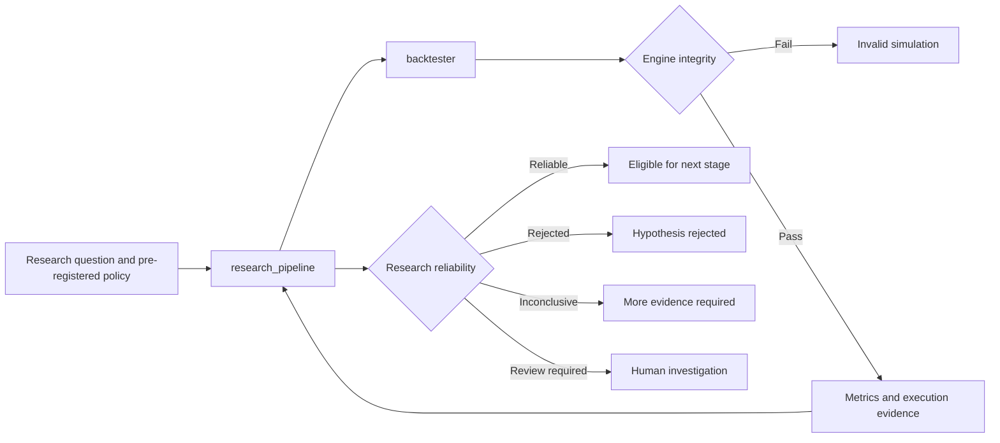

# Backtest decision boundaries and package cleanup plan

**Date:** 2026-10-17  
**Status:** Implemented locally on 2026-10-17; external activation gates remain
**Scope:** Engine-integrity ownership, research-reliability ownership, package
boundaries, and reconciliation of remaining work from the September 9 plan and
October 14 architecture audit

## 1. Decision

The backtest system needs two separate deterministic decisions:

1. **Did the engine run correctly?**
   - Owned by `vibe/backtester`.
   - Judges arithmetic, accounting, execution mechanics, and simulator
     invariants.
   - Produces an `EngineIntegrityReport`.

2. **Is the result reliable and stable?**
   - Owned by `vibe/research_pipeline`.
   - Judges methodology, data and split validity, sufficiency, out-of-sample
     evidence, robustness, stability, and pre-registered research acceptance.
   - Produces a `StudyReliabilityReport`.

`vibe/research_journal` remains a notebook and registry facade over the shared
SQLite research store. It does not execute simulations and does not decide
either verdict.

This separation is necessary because a correctly executed simulation can
produce evidence that rejects the hypothesis. The current real ORB-duration
experiment is the reference example:

- engine and persisted run validation: passed;
- procedure execution: completed;
- stitched held-out expectancy: approximately `-0.0245R` over 80 trades;
- research conclusion: the evidence does not support promotion.

`completed` must therefore never be used as a synonym for `reliable`.



## 2. Target package responsibilities

### `vibe/backtester`

Keep the deterministic simulation kernel here:

- market-data loading needed by simulation;
- signal evaluation and order generation;
- order queues, fills, volume, impact, commissions, and slippage;
- single-symbol and shared-capital portfolio execution;
- positions, cash, buying power, exposure, and equity;
- trade, equity, and normalized metric calculation;
- accounting reconciliation;
- execution and metric invariants;
- the structured engine-integrity verdict.

The backtester must not know about SQLite research storage, Supabase,
experiment registries, publication outboxes, hypotheses, or dashboard state.

### `vibe/research_pipeline`

Keep research methodology and orchestration here:

- study requests and immutable research-policy identity;
- temporal split planning, purge, embargo, and warmup;
- feature availability and leakage checks;
- optimizer, selector, and frozen-candidate evaluation;
- nested walk-forward and stitched held-out evidence;
- data-integrity and dataset-identity validation;
- sufficiency and plausibility diagnostics;
- sensitivity, robustness, regime, and portfolio study orchestration;
- final-holdout authorization and pre-registered acceptance;
- the structured study-reliability verdict;
- run/experiment persistence, publication, and analysis adapters.

The research pipeline must require a passing engine-integrity report before it
uses a run for selection, aggregation, or reliability evaluation. It must not
reimplement accounting rules owned by the backtester.

### `vibe/research_journal`

Keep the user-facing notebook facade:

- hypotheses;
- experiment notes and conclusions;
- rejected ideas;
- narrative observations;
- lineage and artifact references.

It continues to use the same SQLite research store as
`vibe/research_pipeline`; it is not a second system of record.

## 3. Decision block 1: engine integrity

### 3.1 Existing foundation

The core behavior already exists:

- independently observed cash ledger entries;
- final-equity versus realized-P&L reconciliation;
- per-fill cash-delta reconciliation;
- entry/exit/open-quantity parity;
- gross P&L, costs, and net P&L reconciliation;
- cash and leverage limits;
- execution-model version evidence;
- trade census and R-sample checks;
- expectancy and session-Sharpe recomputation;
- equity-curve structural checks;
- single-symbol and portfolio execution diagnostics.

The latest nested-run lifecycle fix also makes these checks reachable from real
persisted nested studies.

### 3.2 Remaining gap

Ownership is currently wrong and diagnostic detail is incomplete:

- several engine-level checks live in
  `vibe/research_pipeline/validation.py`;
- `BacktestResult.execution_diagnostics` retains only aggregate reconciliation
  counts rather than each reconciliation identity, residual, and explanation;
- the research pipeline must reconstruct the engine-correctness verdict from
  loosely related result fields;
- `RunState.COMPLETED` currently mixes execution validity with broader research
  validation terminology.

### 3.3 Planned contract

Add an immutable `EngineIntegrityReport` to every current backtest result:

```text
EngineIntegrityReport
├── status: PASS | FAIL
├── engine_version
├── metric_calculation_version
├── checked_categories
└── findings[]
    ├── check_id
    ├── category
    ├── observed
    ├── expected
    ├── residual
    ├── applicable
    └── context
```

Backtester-owned categories:

- metric mathematics;
- cross-metric consistency;
- equity-series consistency;
- accounting;
- execution mechanics;
- cash, leverage, and position invariants;
- required session-end state;
- deterministic execution-model identity.

An absent report is not a pass. New research execution must fail closed when
engine-integrity evidence is missing.

## 4. Decision block 2: research reliability

### 4.1 Existing foundation

The pipeline already produces much of the required evidence:

- exchange-session train/validation/test splits;
- purge and embargo;
- warmup exclusion;
- full-grid training evaluation;
- connected-plateau validation selection;
- frozen test evaluation;
- all-fold, non-overlapping stitched OOS evidence;
- data-integrity checks;
- six required leakage checks;
- feature-registry identity;
- minimum-trade and minimum-session checks;
- plausibility diagnostics;
- locked final holdout and append-only access log;
- a pre-registered final-holdout acceptance rule.

### 4.2 Remaining gap

There is no deterministic study-level reliability decision:

- a study becomes `completed` when every fold executes and its individual run
  validation passes;
- stitched OOS evidence is displayed but is not judged against a registered
  reliability policy;
- fold consistency and validation-to-test degradation are not gated;
- parameter-selection stability is recorded but not judged;
- generic acceptance findings are advisory and cannot reject a study;
- the final-holdout acceptance evaluator exists but has no supported execution
  command that applies and persists the verdict;
- robustness is not part of nested-study completion;
- parameter perturbation and random subsampling remain unimplemented in the
  legacy robustness analyzer.

### 4.3 Planned contract

Add an immutable, versioned `ReliabilityPolicy` before a study begins. It may
declare:

- minimum stitched OOS trades and sessions;
- minimum stitched OOS expectancy;
- optional Sharpe, drawdown, payoff, or cost constraints;
- minimum acceptable fold consistency;
- maximum validation-to-test degradation;
- acceptable parameter-selection movement across folds;
- plateau width and selection-margin requirements;
- required cost/slippage stress survival;
- required parameter-neighborhood robustness;
- regime coverage and return-concentration bounds;
- whether shared-capital portfolio evidence is required;
- which findings require review rather than rejection.

The evaluator returns:

```text
StudyReliabilityReport
├── verdict: RELIABLE | REJECTED | INCONCLUSIVE | REVIEW_REQUIRED
├── policy_hash
├── engine_integrity_complete
├── stitched_oos_summary
├── fold_stability_summary
├── robustness_summary
├── holdout_summary
└── criteria[]
    ├── criterion_id
    ├── outcome
    ├── observed
    ├── expected
    └── evidence references
```

Human interpretation of why a hypothesis failed remains outside the
deterministic evaluator. The dashboard supplies the evidence; the researcher
and assistant form or revise the hypothesis.

## 5. Methodology freeze and final holdout

The October 14 audit's methodology-freeze gap remains open.

Current immutable fingerprints and experiment definitions make changes
detectable, but there is no explicit action that says:

> This methodology and reliability policy are frozen; unseen evaluation may
> now begin.

Plan:

1. Introduce a frozen study-definition identity containing:
   - strategy/ruleset identity;
   - universe and dataset IDs;
   - parameter axes;
   - split and warmup policy;
   - execution and metric versions;
   - leakage requirements;
   - reliability policy;
   - final-holdout lock hash.
2. Persist a `frozen_at`, `frozen_by`, and immutable definition hash.
3. Refuse final-holdout execution for an unfrozen definition.
4. Add a dedicated final-holdout command requiring an attributed unlock token.
5. Apply the committed acceptance rule exactly once.
6. Persist `PASSED`, `FAILED`, or `INCONCLUSIVE` separately from ordinary run
   completion.
7. Preserve the existing lineage touch-count promotion block.

## 6. Robustness completion

Replace the current disconnected robustness score with reproducible evidence
owned by `research_pipeline`.

Required slices:

1. **Execution-cost stress**
   - declared slippage and commission envelope;
   - pass/fail against conservative cost assumptions.
2. **Parameter-neighborhood robustness**
   - deterministic adjacent values;
   - cliff and sign-change detection;
   - reuse selector plateau topology.
3. **Temporal stability**
   - positive/negative fold balance;
   - worst-fold behavior;
   - validation-to-test degradation;
   - dependence on a single period.
4. **Regime stability**
   - predeclared regime labels;
   - coverage and concentration;
   - no ex-post regime selection.
5. **Seeded subsampling or bootstrap diagnostics**
   - deterministic seed and sample identity;
   - advisory unless a justified policy is pre-registered.
6. **Multiple-testing diagnostics**
   - retain `n_candidates_evaluated`;
   - add deflated Sharpe or probability-of-backtest-overfitting only when its
     policy and interpretation are explicitly adopted.

## 7. Portfolio integration

Shared-capital portfolio simulation exists and is tested, but it has no
standard research entry point in `scripts/` and is not composed into nested
study reliability.

Plan:

- add a portfolio segment executor implementing the same research-pipeline
  candidate contract;
- persist pooled and per-symbol evidence under one experiment;
- require shared-capital evidence for claims scoped to multiple symbols;
- include concentration, contention, leverage, incomplete sessions, and
  rejected signals in the reliability policy;
- keep single-symbol execution available for explicitly single-symbol
  hypotheses;
- do not mistake independent per-symbol capital resets for a portfolio.

## 8. Package cleanup

### 8.1 Keep in `vibe/backtester`

- `core/engine.py`
- `core/portfolio_engine.py`
- `core/portfolio.py`
- `core/reconciliation.py`
- `core/execution/`
- execution realism, commissions, slippage, and fill simulation;
- simulator-facing data loading;
- metric and performance calculation;
- the new integrity contracts and checks.

### 8.2 Move to `vibe/research_pipeline`

Research-specific modules currently under `vibe/backtester`:

- `analysis/research_sink.py`;
- `analysis/research_evidence.py`;
- parameter-sweep orchestration;
- sensitivity orchestration;
- robustness orchestration;
- regime-research orchestration;
- optimization scoring and parameter-surface analysis;
- research-window helpers that are not engine primitives.

Moves must preserve import compatibility for one release when an external
caller may exist. New code must import the new locations.

### 8.3 Delete after migration

- deprecated fixed-parameter `analysis/walk_forward.py`;
- obsolete `OptimizationPipeline` integration with that module;
- superseded wrappers and duplicate command-line entry points;
- compatibility exports after their announced removal window.

The fixed-parameter cross-period comparison is legitimate only if retained
under a truthful regime-comparison name. It must not continue under
“walk-forward” terminology.

### 8.4 Retain or relocate

- keep `research_journal` as the SQLite-backed notebook facade;
- move its backtester integration trackers to the journal or pipeline adapter
  layer if they remain supported;
- retain hard-failure compatibility shims that prevent unsafe publication.

### 8.5 Dependency rule

Add an architecture test enforcing:

```text
research_pipeline -> backtester
research_journal -> research_pipeline storage
backtester -X-> research_pipeline
```

The current reverse imports from backtester research adapters must disappear.

## 9. Persistence and dashboard

Use a forward-only migration after schema v11.

Persist separately:

- engine-integrity reports keyed by run;
- study-reliability reports keyed by experiment;
- reliability-policy identity and hash;
- structured criterion outcomes;
- robustness evidence and provenance;
- methodology-freeze identity.

Historical records are not automatically reclassified. Where evidence was not
captured, display `Not assessed`.

Dashboard presentation:

- **Engine integrity:** Passed / Failed / Not assessed.
- **Procedure execution:** Completed / Failed / Interrupted.
- **Research reliability:** Reliable / Rejected / Inconclusive / Review.
- detailed accounting identities and residuals for engine failures;
- failed reliability criteria, folds, and robustness evidence for rejected
  studies;
- no green “completed” presentation that implies economic validation.

## 10. Reconciliation of the September 9 implementation plan

### Implemented or superseded

The following original gaps are implemented in the current branch:

- SQLite research storage, migrations, leases, evidence, retention, and
  publication outbox;
- metric normalization;
- execution realism, costs, buying power, and accounting reconciliation;
- exchange-session split planning, warmup, purge, and embargo;
- feature declarations and leakage harness;
- cross-sectional universe analysis;
- run validation lifecycle;
- genuine nested walk-forward entry point;
- segment-role persistence;
- explicit parent experiments and fold/run membership;
- final-holdout lock and repeated-touch promotion block;
- shared-capital portfolio engine;
- local SQLite viewer and experiment-first inspection;
- remote dashboard adapters and flexible analyzer implementation;
- approved-dataset manifest, verification, cache, and synchronization tooling;
- artifact staging, fenced outbox, reconciliation, and safe preview contracts;
- legacy YAML archival and active-tree removal.

### Status after implementation

Items 1 through 11 from the original open-code list are resolved by this
implementation: the decision reports, reliability evaluator, methodology
freeze, exactly-once final holdout, robustness composition, portfolio research
entry point, legacy deletion, package relocation, persistence/dashboard
presentation, typed frozen study definition, and retention policy are now
implemented.

The remaining limitations require additional source data or external
activation rather than more deterministic decision-boundary composition:

1. Point-in-time universe membership, delistings, and complete
   corporate-action history remain incomplete. Static declared universes
   retain their survivorship-bias badge.
2. Slippage calibration against live fills remains a data limitation.
3. Browser-level E2E coverage beyond the checked-in server, adapter, route,
   and production-build checks remains desirable.

### External activation gates

These are not missing deterministic core code, but the system is not fully
operational across devices until they are completed:

- confirm Databento private multi-device redistribution entitlement;
- record owner approval for dataset publication;
- deploy and independently review Supabase schemas, RLS, RPCs, and private
  buckets;
- provision dedicated server-side credentials;
- deploy and review the signed-preview Edge Function;
- backfill and reconcile terminal research publications;
- validate anonymous multi-page dashboard reads;
- load-test cardinality, response size, timeouts, and query plans;
- test interrupted dataset/artifact upload and reconciliation recovery;
- verify dashboard CSP origins;
- activate the production `/research` data source rather than fixture mode.

The concrete remote artifact backend exists in commit `48b785d` on repository
history, with a later equivalent implementation on
`wenting-luo2993-remote-artifact-storage`; deployment and security gates still
remain. No licensed data or artifact bytes should be uploaded before those
gates pass.

## 11. Reconciliation of the October 14 architecture audit

| Audit item | Current status |
| --- | --- |
| G1 genuine nested walk-forward unreachable | Resolved |
| G2 legacy walk-forward presented as OOS | Resolved; legacy implementation and wrappers deleted |
| G3 legacy rows asserted TEST provenance | New writes fixed; historical data remains historical |
| G4 unstable degradation ratio | Resolved; deterministic validation-to-TEST degradation is evaluated in the genuine path |
| G5 approximate calendar windows | Resolved; the deprecated path was deleted and reliability sums declared TEST sessions |
| G6 methodology freeze | Resolved with immutable hash, timestamp, and Bloom attribution |
| G7 typed run request | Resolved for the decision boundary through the typed frozen study definition |
| G8 inert sweep axes | Resolved for known gated axes |
| Validator reachability | Resolved, including persisted nested segment finalization |
| Queryable/analysable segment role | Resolved |
| Genuine nested recording | Resolved |
| Explicit parent experiments | Resolved |
| Experiment-first local viewer | Resolved |
| Analysis adapter was test-only | Resolved; local and remote analyzer surfaces use it |
| Universe capability awaiting use | Core capability implemented; broader point-in-time universe remains open |
| Portfolio engine awaiting use | Resolved; supported shared-capital research executor implemented |
| Journal duplication concern | Resolved as a false alarm; retain the facade |

## 12. Implementation sequence

1. **Contracts and terminology**
   - Define engine-integrity and study-reliability reports.
   - Define frozen study identity and reliability policy.
   - Pin lifecycle vocabulary with tests.

2. **Backtester integrity ownership**
   - Move engine-level checks.
   - Preserve structured reconciliation findings.
   - Attach the report to single-symbol and portfolio results.

3. **Research-pipeline reliability**
   - Require engine-integrity pass.
   - Evaluate stitched OOS and fold stability.
   - Persist the study verdict.

4. **Robustness completion**
   - Cost stress, parameter neighborhoods, temporal/regime stability, and
     deterministic subsampling.

5. **Methodology freeze and final holdout**
   - Freeze command, authorized final runner, acceptance verdict, and
     one-touch enforcement.

6. **Portfolio composition**
   - Research entry point, experiment persistence, and reliability criteria.

7. **Storage and dashboard**
   - Forward-only migration and separate integrity/reliability presentation.

8. **Package cleanup**
   - Move research adapters and orchestrators.
   - Remove the deprecated walk-forward path.
   - Enforce one-way imports.

9. **Remote activation lane**
   - Licensing, deployment, credentials, reconciliation, load testing, and
     recovery drills.

## 13. Required acceptance tests

- Mutating each accounting identity causes engine-integrity failure.
- Missing engine-integrity evidence fails closed in the research pipeline.
- Single-symbol and portfolio engines implement the same integrity contract.
- A failed engine result cannot enter optimization or selection.
- Reliability thresholds cannot change after study freeze.
- Negative stitched OOS evidence produces `REJECTED`, not `RELIABLE`.
- Too little evidence produces `INCONCLUSIVE`.
- Suspicious but non-dispositive evidence produces `REVIEW_REQUIRED`.
- A study satisfying every registered criterion produces `RELIABLE`.
- The current ORB-duration fixture yields:
  - engine integrity `PASS`;
  - procedure `COMPLETED`;
  - reliability `REJECTED`.
- Holdout access and acceptance are recorded exactly once.
- Multi-symbol claims require shared-capital evidence.
- Historical records without new reports remain `Not assessed`.
- `vibe/backtester` cannot import `vibe.research_pipeline`.
- Existing production golden results remain unchanged unless an intentional
  execution-model version change is approved.

## 14. Explicit non-goals

- Automatically explaining the economic reason a hypothesis failed.
- Automatically rewriting or tuning the strategy after rejection.
- Treating one profitable fold as reliable evidence.
- Treating procedure completion as strategy validation.
- Using the final holdout repeatedly during development.
- Uploading licensed market data before entitlement and security approval.
- Deleting `vibe/backtester`; it remains the execution kernel.

## 15. Implementation record

The approved implementation is now present in the worktree:

- `vibe/backtester/core/integrity.py` owns the immutable engine-integrity
  contract and both engine types attach it to results.
- `vibe/research_pipeline/reliability.py`, `robustness.py`, and
  `methodology.py` own policy, study reliability, deterministic robustness,
  freeze identity, and Bloom-attributed final-holdout authorization.
- New research execution fails closed when engine-integrity evidence is absent.
- Nested walk-forward uses stitched TEST evidence, exact TEST session counts,
  fold stability, validation degradation, parameter movement/neighborhoods,
  cost stress, predeclared regimes, and seeded bootstrap provenance.
- Multi-symbol reliability requires evidence produced by the shared-capital
  `PortfolioBacktestEngine` research executor.
- SQLite migrations v12 and v13 add integrity, reliability, robustness,
  frozen-study, final-holdout authorization/claim, and retention records.
  Historical v10/v11 databases remain readable and display the new decisions
  as `Not assessed`.
- Research-specific analysis modules live under `vibe/research_pipeline`.
  The deprecated fixed-parameter walk-forward and `OptimizationPipeline` path
  were deleted; an AST dependency test prohibits `vibe/backtester` from
  importing either `vibe.research_pipeline` or `vibe.research_journal`.
- The local viewer and remote dashboard show engine integrity, procedure
  execution, and research reliability as separate concepts.

### Reliability Policy v1 defaults and rationale

Policy v1 is immutable after freeze and may be explicitly overridden with
typed values before freeze. Its defaults are deliberately conservative:

| Criterion | Default | Rationale |
|---|---:|---|
| Stitched held-out trades | 100 minimum | Avoid promoting a result dominated by a very small trade sample. |
| Declared TEST sessions | 120 minimum | Require temporal coverage measured from exchange-session evidence, not calendar-span guesses. |
| Stitched held-out expectancy | at least `0.0R` | Negative held-out expectancy rejects the hypothesis; this is not a profitability guarantee. |
| Positive TEST folds | 60% minimum | Discourage promotion based on one exceptional fold. |
| Mean validation-to-TEST degradation | `0.25R` maximum | Bound selection decay without claiming it can be eliminated. |
| Mean parameter movement | 1.5 Manhattan grid steps maximum | Detect unstable fold-to-fold selections. |
| Plateau width | 2 candidates minimum | Require support beyond a single isolated optimum. |
| Cost stress | required; expectancy at least `0.0R` | Ensure declared adverse execution costs do not reverse the result. |
| Profitable parameter neighbors | 50% minimum | Detect cliffs around the selected point. |
| Predeclared regimes | at least 2; concentration at most 80% | Avoid an undeclared or single-regime explanation of the result. |
| Seeded subsampling/bootstrap | required, advisory | Preserve reproducible diagnostics without fabricating an unsupported p-value. |
| Shared capital for multi-symbol claims | required | Independent symbol runs cannot establish portfolio-capital behavior. |

Verdict precedence is deterministic: a dispositive failed criterion produces
`REJECTED`; missing required evidence produces `INCONCLUSIVE`; suspicious
non-dispositive evidence produces `REVIEW_REQUIRED`; only all registered
criteria passing produces `RELIABLE`. The approximately `-0.0245R`, 80-trade
ORB reference is therefore `REJECTED`, even though it is also below the
sufficiency target.

### Retention behavior

Run summaries and decision evidence are retained indefinitely. Frozen,
promoted, and final-holdout study detail is protected indefinitely. Ordinary
exploratory trade/equity detail is configurable and can be pruned only through
an explicit attributed API/CLI call with a reason; no scheduled or automatic
destructive pruning is enabled.

### External activation gates

Local code, migration, viewer, dashboard, and tests require no external
activation. Supabase deployment/reconciliation, licensed-data upload, provider
credentials, and Databento entitlement remain separate operator-controlled
gates. This implementation does not claim those gates have been completed.
