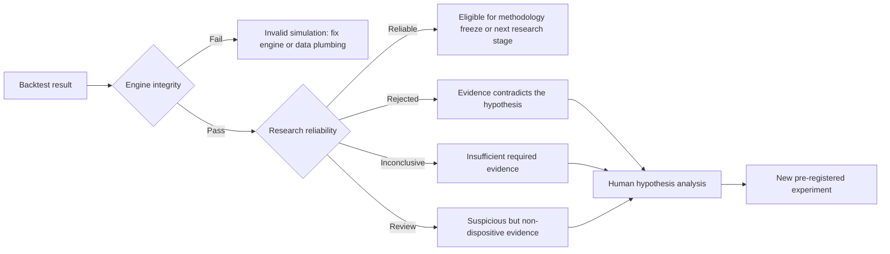

# Engine integrity, research reliability, and hypothesis analysis

**Date:** 2026-10-18  
**Purpose:** Explain the two deterministic backtest decisions and the separate
human research process for understanding a rejected hypothesis.

## 1. The three questions are different

The research workflow must answer three questions in order:

1. **Did the simulator run correctly?**
   - Deterministic.
   - Owned by `vibe/backtester`.
   - Answered by `EngineIntegrityReport`.
2. **Is the resulting research evidence sufficiently reliable and stable?**
   - Deterministic against a policy registered before the study runs.
   - Owned by `vibe/research_pipeline`.
   - Answered by `StudyReliabilityReport`.
3. **Why did the hypothesis fail, and what should we investigate next?**
   - Interpretive research.
   - Performed by the researcher, assisted by analysis tools.
   - Produces a new or revised hypothesis, not an automatic strategy mutation.

A correct engine can faithfully demonstrate that a strategy hypothesis does
not work. An unreliable result does not necessarily mean the engine is broken.
Likewise, a deterministic rejection does not by itself identify the economic
reason for failure.

## 2. Decision block 1: engine integrity

### 2.1 What it means

An engine-integrity pass means:

> Given the declared inputs and execution model, the simulator's arithmetic,
> accounting, fills, positions, cash, and reported metrics are internally
> consistent.

It does **not** mean:

- the strategy is profitable;
- the sample is large enough;
- the selected parameters are stable;
- the data is free from every research bias;
- the result is likely to repeat in live trading.

### 2.2 What the engine checks

Every single-symbol and shared-capital portfolio result carries an immutable
`EngineIntegrityReport`. Missing evidence is not treated as a pass.

| Category | Examples of checks | Failure implication |
| --- | --- | --- |
| Metric mathematics | Published metrics are finite; win rate stays in `[0, 1]`; drawdown stays in valid bounds | Metrics cannot be trusted |
| Cross-metric consistency | Trade count equals the ledger; wins/losses/breakevens match the R sample; expectancy is independently recomputed | Summary metrics disagree with underlying trades |
| Equity-series consistency | Equity points are finite, positive, ordered, and unique; session count and Sharpe are independently recomputed | Time-series evidence is malformed or miscalculated |
| Accounting | Gross P&L minus costs equals net P&L; final equity reconciles to trade P&L and costs; fill cash movements reconcile | Money was created, lost, double-counted, or assigned incorrectly |
| Execution mechanics | Published costs match execution diagnostics; fill and position quantities reconcile | Order/fill lifecycle behaved inconsistently |
| Cash and leverage | Buying-power rules and declared leverage ceilings were respected | The simulated strategy used capital it was not allowed to use |
| Position and session-end state | Required positions and pending orders are closed or accounted for | The run ended with hidden or unresolved exposure |
| Execution-model identity | The run names the execution-model and metric-calculation versions that produced it | The result cannot be compared or reproduced honestly |

Each finding preserves:

- check identity;
- category;
- observed and expected values;
- numerical residual when applicable;
- whether the check applied;
- contextual evidence.

### 2.3 What happens when integrity fails

The research pipeline fails closed:

- the result cannot participate in optimization or selection;
- it cannot contribute to stitched out-of-sample evidence;
- it cannot be classified as reliable;
- the failure is an engineering problem, not a strategy conclusion.

The correct response is to repair the engine, data plumbing, accounting, or
execution model and rerun the affected evidence. It is not valid to explain
away an integrity failure economically.

## 3. Decision block 2: research reliability

### 3.1 What it means

A research-reliability decision asks:

> Assuming the engine ran correctly, does the predeclared research procedure
> provide enough stable, genuinely held-out evidence to support the claim?

The decision uses immutable Reliability Policy v1. Policy values may be
changed before a study begins, but not after observing its outcomes.

### 3.2 Verdicts

| Verdict | Meaning |
| --- | --- |
| `RELIABLE` | Every required registered criterion passed. The result is eligible for the next research stage; this is not a guarantee of future profit. |
| `REJECTED` | At least one dispositive criterion failed. The evidence contradicts the registered hypothesis or promotion claim. |
| `INCONCLUSIVE` | Required evidence is missing or insufficient. The hypothesis has not passed or failed convincingly. |
| `REVIEW_REQUIRED` | Evidence is suspicious or unusual but not dispositive under the registered policy. Human investigation is required. |

Failure outranks insufficiency. For example, negative held-out expectancy is a
rejection even when the trade count is also below the sufficiency target.

### 3.3 Reliability Policy v1 checks

| Area | Default deterministic check |
| --- | --- |
| Engine prerequisite | Every frozen TEST result must have engine integrity `PASS` |
| Procedure | Every declared fold completed and stitched TEST evidence exists |
| Held-out expectancy | Stitched TEST expectancy must be at least `0.0R` |
| Sufficiency | At least 100 stitched TEST trades and 120 declared TEST sessions |
| Fold consistency | At least 60% of TEST folds have positive expectancy |
| Selection degradation | Mean validation-to-TEST degradation is at most `0.25R` |
| Parameter stability | Mean movement between adjacent-fold selections is at most 1.5 grid steps |
| Plateau support | Each selected validation plateau contains at least two candidates; a singleton requests review |
| Data integrity | Required data-integrity evidence passed |
| Leakage | Required temporal and feature-availability checks passed |
| Cost stress | Conservative predeclared cost scenarios retain expectancy of at least `0.0R` |
| Parameter neighborhood | At least 50% of adjacent candidates are non-negative, with no sign change or performance cliff |
| Regime evidence | At least two predeclared regimes are represented and no regime contributes more than 80% of absolute returns |
| Seeded subsampling | Reproducible bootstrap/subsampling evidence exists; Policy v1 treats it as advisory |
| Multiple testing | Candidate count is retained; no unsupported adjusted statistic is invented |
| Portfolio evidence | Multi-symbol claims require one shared-capital portfolio simulation |

The final holdout has a separate, stricter pre-registered rule:

- expectancy at least `0.10R`;
- at least 200 trades;
- methodology must be frozen;
- access must use an attributed, exactly-once authorization.

## 4. What happened in the real ORB-duration experiment

Experiment:

- title: `ORB duration comparison - full decision evidence`;
- experiment ID: `01a1517f-9e61-70e2-8e9b-5e83eba78711`;
- symbol: QQQ;
- candidates: 5, 15, and 30-minute opening ranges;
- two completed nested folds;
- 14 recorded train, validation, and test runs.

### 4.1 Engine decision

**Engine integrity: passed.**

- All 14 recorded segment runs completed.
- All 14 engine-integrity reports passed.
- The SQLite database integrity check passed.

The resulting evidence is therefore suitable for judging the hypothesis. The
rejection is not caused by a broken accounting identity or simulator failure.

### 4.2 Research decision

**Research reliability: rejected.**

Observed evidence:

| Evidence | Result | Interpretation |
| --- | ---: | --- |
| Fold 1 selection | 15 minutes | Selection changed between folds |
| Fold 1 TEST expectancy | `+0.0181R`, 40 trades | Slightly positive but economically weak |
| Fold 2 selection | 5 minutes | Different part of the parameter surface |
| Fold 2 TEST expectancy | `-0.0671R`, 40 trades | Negative genuinely unseen evidence |
| Stitched TEST expectancy | `-0.0245R`, 80 trades | Direct rejection under Policy v1 |
| Positive TEST folds | 50% | Below the required 60% |
| Validation-to-TEST degradation | `0.2246R` | Passed the `0.25R` limit, but most validation strength disappeared |
| Plateau width | One candidate in each selected plateau | Selection is isolated rather than broadly supported |
| Four/two-tick cost stress | `-0.0370R` | Negative after moderately wider costs |
| Six/three-tick cost stress | `-0.0492R` | Further deterioration under conservative costs |
| Adjacent parameter behavior | Sign change and cliff | The surface is unstable around selected values |
| Sufficiency | 80 trades and 80 TEST sessions | Below the 100/120 targets |
| Regime evidence | No predeclared regime map | Required regime claim cannot be supported |

The correct conclusion is:

> The tested claim that one globally selected ORB duration is stable enough for
> promotion is not supported by this development evidence.

This does not prove that every ORB strategy is impossible. It rejects this
specific hypothesis, candidate space, methodology, and evidence set.

## 5. How I would analyze the failure reason

The deterministic verdict tells us **that** the claim failed. Failure analysis
asks **why**, without using the answer to retroactively change the completed
study.

### Step 1: Preserve the completed study

Do not:

- change its thresholds after seeing the result;
- relabel validation or TEST windows;
- choose 15 minutes because Fold 1 was positive;
- choose 5 minutes because it won Fold 2 validation;
- rerun small variations until one turns green;
- touch the locked final holdout.

The rejected experiment remains immutable evidence.

### Step 2: Decompose where performance changed

Create descriptive, non-promotional analyses of the frozen TEST trades:

- fold, month, and session;
- long versus short;
- entry time;
- exit reason;
- initial risk and realized R distribution;
- win rate, payoff ratio, tail contribution, and losing streaks;
- transaction-cost contribution;
- selected duration and adjacent-duration results;
- concentration in a few days or trades.

The goal is to locate the failure, not select a new rule from the same TEST
sample.

### Step 3: Test causal explanations

Analyze only information available at the trade decision time. Candidate
explanations may include:

- opening volatility or opening-range size;
- overnight gap;
- trailing volatility such as ATR/ADR;
- causal trend state;
- relative volume observed by the entry timestamp;
- long/short asymmetry;
- early versus late breakout timing;
- market-wide risk regime known before entry.

Full-day range, future volume, the eventual daily trend, and other
post-decision facts may describe a losing trade but cannot become promotable
filters.

### Step 4: Distinguish likely failure modes

For this experiment I would investigate, in order:

1. **The duration hypothesis may be conditional rather than global.**
   - Fold selections moved from 15 to 5 minutes.
   - This suggests, but does not prove, that the useful duration may depend on
     a pre-entry volatility or market-state variable.
2. **The selection may be noisy.**
   - Both selected plateaus were singletons.
   - Adjacent settings changed sign and showed cliffs.
   - A winner may be a local sample artifact rather than a stable region.
3. **The gross edge may be too small for execution uncertainty.**
   - Baseline stitched expectancy was already negative.
   - Wider cost assumptions made it more negative.
   - Cost tuning cannot rescue a strategy whose held-out expectancy is below
     zero.
4. **The sample may be too short to characterize conditional behavior.**
   - Eighty TEST trades and sessions are below policy sufficiency.
   - More development evidence may reduce uncertainty, but cannot erase the
     observed negative evidence.
5. **ORB duration alone may be the wrong explanatory variable.**
   - The true hypothesis may concern breakout quality, volatility context,
     direction, or entry timing rather than a universally optimal opening
     window.

These are hypotheses to investigate, not conclusions established by the
current experiment.

## 6. How I would improve the next experiments

### 6.1 Run diagnosis before optimization

Produce a failure-attribution report from the completed experiment:

- which trades and periods dominate losses;
- whether losses cluster by side, entry time, exit reason, or causal regime;
- whether the parameter surface changes consistently with any pre-entry
  feature;
- whether apparent improvements depend on a handful of observations.

This report remains descriptive and must clearly identify any analysis that
looked at TEST outcomes.

### 6.2 Write a narrower hypothesis

Replace “find the best ORB duration” with a falsifiable claim such as:

> A predeclared opening-volatility state determines whether a short or medium
> ORB window is appropriate, and that mapping improves stitched held-out
> expectancy without parameter cliffs after conservative costs.

That wording is only an example. The actual hypothesis should come from the
diagnostic evidence and market rationale.

### 6.3 Pre-register the next study

Before running it, declare:

- causal regime definition and availability timestamp;
- candidate rules;
- exact parameter axes;
- nested split plan;
- cost-stress scenarios;
- reliability thresholds;
- minimum samples per regime;
- stopping and rejection rules;
- whether the claim is single-symbol or portfolio-level.

If diagnostics examined the current TEST sample, the revised rule must be
evaluated on later untouched development data or newly designated nested
folds. The same inspected observations cannot be presented as fresh
confirmation.

### 6.4 Prefer stable regions over point winners

The selector should continue to prefer connected plateaus rather than the
highest isolated score. A useful next study should seek:

- neighboring parameters with the same sign;
- gradual rather than cliff-like changes;
- consistent fold behavior;
- survival under wider costs;
- adequate trades and sessions in every required subgroup.

Adding a denser grid is not automatically better. It increases the search
space and multiple-testing burden. Add candidates only where the revised
hypothesis predicts a meaningful boundary.

### 6.5 Increase evidence honestly

Use additional pre-final-holdout development history and more nested folds
where available. Do not repeatedly query the locked 2025–2026 final holdout.

More observations should improve:

- trade and session sufficiency;
- coverage of predeclared regimes;
- estimation of fold consistency;
- robustness of the parameter surface;
- cost and tail-risk estimates.

### 6.6 Promote only after the revised hypothesis passes

The progression should be:

1. descriptive failure analysis;
2. new causal hypothesis;
3. pre-registered development study;
4. nested held-out reliability pass;
5. methodology freeze by `Bloom`;
6. exactly-once final-holdout evaluation;
7. portfolio evaluation if the claim spans multiple symbols;
8. paper/live calibration before capital promotion.

## 7. What the assistant should produce when asked to analyze a failure

A useful failure-analysis deliverable should contain:

1. **Decision summary**
   - Engine integrity, procedure state, and reliability verdict kept separate.
2. **Failed and inconclusive criteria**
   - Exact observed values, thresholds, and evidence references.
3. **Descriptive attribution**
   - Where returns, costs, and instability are concentrated.
4. **Candidate explanations**
   - Ranked by supporting evidence and clearly labeled as hypotheses.
5. **Bias review**
   - Which observations came from train, validation, TEST, or final holdout.
6. **Proposed next hypotheses**
   - Causal, falsifiable, and materially different from post-hoc tuning.
7. **Experiment designs**
   - Data range, splits, parameters, regime definitions, policy, and stopping
     rules specified before execution.
8. **Recommendation**
   - Reject, collect more evidence, investigate, or prepare for freeze.

The assistant should not automatically edit strategy code, launch a parameter
sweep, or recommend promotion merely because it found a profitable subgroup.
Those actions require a new declared hypothesis and a new honest experiment.

## 8. Recommended immediate next step for ORB research

The next step is **not** another blind duration sweep.

Create a descriptive failure-attribution analysis of experiment
`01a1517f-9e61-70e2-8e9b-5e83eba78711`, focused on:

- fold and monthly return distributions;
- long/short behavior;
- entry-time and exit-reason attribution;
- opening-range size and trailing-volatility regimes known before entry;
- cost and tail concentration;
- why adjacent durations changed sign.

Use that analysis to write one or two pre-registered causal hypotheses. Only
then run a new nested experiment on development evidence not being reused as
fresh confirmation.
