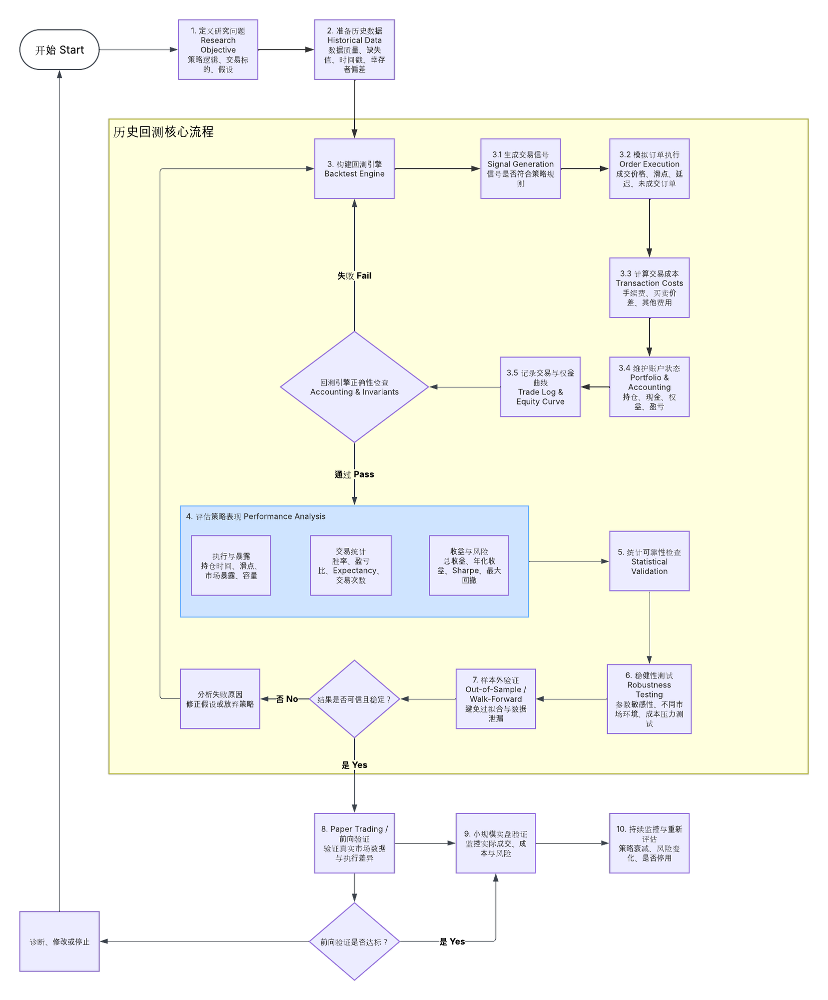
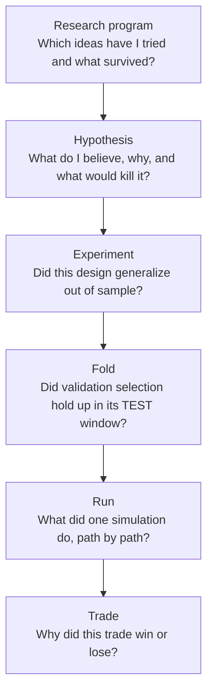

# Backtest research north star

**Date:** 2026-10-31  
**Status:** Target picture and roadmap; no implementation in this document  
**Audience:** Bloom, and any agent continuing backtest research work  
**Read with:** `2026-10-18-backtest-handoff.md`,
`2026-10-18-orb-direction-statistical-reliability-v2.md`,
`2026-10-17-backtest-decision-boundaries-and-cleanup-plan.md`

## 1. Why this document exists

The backtest system has been built bottom-up: a deterministic engine,
engine-integrity reports, nested walk-forward, Reliability Policy v2, Supabase
publication and a local viewer. Each piece is sound, but the work has started to
loop because there was no written picture of what the finished system should
let a researcher *understand*.

The current viewer mostly answers **"may I trust this verdict?"** It shows
criterion IDs, pass/fail outcomes and audit tables. It does not yet answer the
questions a researcher actually needs:

- What did I expect, and was that expectation even testable?
- What happened, visually, across the whole held-out record?
- Where does the edge come from, and when does it disappear?
- Is the result distinguishable from noise, given how much I searched?
- What did I learn, and what should I test next?

The goal of the research platform is therefore:

> **Turn every experiment into a decision and a lesson, not just a verdict.**

A rejected or inconclusive experiment is a successful research outcome when it
clearly explains *why*, and narrows what to try next.

## 2. The end-to-end picture

The research loop follows the high-level backtest flow diagram (历史回测流程):



The table records which steps are mature and which are thin.

| Diagram step | Purpose | Current state |
| --- | --- | --- |
| 1. Research objective | State the hypothesis, mechanism, prediction and kill criteria | **Thin.** `Hypothesis` has title and rationale only; no records exist in the active registry |
| 2. Historical data | Data quality, gaps, timestamps, survivorship | Implemented in the pipeline; not summarized in the viewer |
| 3 / 3.1–3.5. Engine | Signals, execution, costs, accounting, trade log and equity | **Strong** |
| Engine correctness check | Accounting and invariants | **Strong** (`vibe/backtester/core/integrity.py`) |
| 4. Performance analysis | Execution/exposure, trade statistics, return/risk | **Run level only.** Missing at experiment level |
| 5. Statistical validation | Is the effect distinguishable from noise? | **Strong computation**, shown as tables and raw JSON |
| 6. Robustness | Parameters, regimes, cost stress | **Computed**, not visualized |
| 7. Out-of-sample / walk-forward | Avoid overfitting and leakage | **Strong** |
| "Credible and stable?" decision | Act on the evidence | **Verdict only**; no recorded lesson or next step |
| 8–10. Paper, small live, monitoring | Forward validation | Out of scope until a hypothesis survives step 7 |

The engineering and governance layers (3, 5 and 7) are ahead of the
understanding layers (1, 4 and the decision). The next phase should rebalance
toward understanding rather than adding further gates.

## 3. Information hierarchy

Each level of the viewer should answer exactly one kind of question.



| Level | Question | Primary visuals |
| --- | --- | --- |
| Research program | Which hypotheses are open, rejected or surviving? How many variants have I tried in total? | Hypothesis list with status, total trial count, decision log |
| Hypothesis | What is the claim, mechanism, prediction and kill rule? | Hypothesis card, linked experiments, lessons learned |
| Experiment | Is the edge real, where does it come from, and is it fragile? | Section 4 report |
| Fold | Did the validation choice hold up in its TEST window? | Train/validation/TEST comparison, selected vs neighbours |
| Run | What was the realized equity and risk path? | Existing run dialog: equity, drawdown, session returns, trades |
| Trade | Why did this trade behave as it did? | Entry context, R-multiple, MAE/MFE, exit reason |

The run and trade levels are largely implemented. The program, hypothesis and
experiment levels are the main gap.

## 4. Target experiment report

An experiment page should read top-down like a short research report. Each
section has one question, its visuals, how to read them, and its current state.

### 4.1 What did I test, and what did I expect?

**Show:**

- hypothesis statement and market mechanism (why the edge should exist);
- predeclared prediction, for example "long-only 15-minute ORB has positive
  net expectancy above `0.10R`";
- kill criteria, for example "reject if the 95% interval upper bound is below
  `0.05R`";
- candidate grid, fold plan and total number of variants tried;
- **design power**: the smallest edge this design can reliably detect, and the
  trade count needed for the edge size of interest (see Section 5).

**How to read it:** if the minimum detectable edge is larger than any plausible
edge, the experiment can only end as *inconclusive*. Redesign before running.

**State:** missing. Experiment definitions record the grid and fold plan, but
not hypothesis, prediction, kill criteria or power.

### 4.2 Can I trust the plumbing?

**Show:** one collapsed line: data integrity, engine integrity, leakage,
procedure completion. Expand only on failure.

**How to read it:** this is a gate, not an insight. When it passes it should
take almost no screen space.

**State:** implemented, but given equal visual weight to the research criteria.

### 4.3 What happened?

**Show:**

- **stitched TEST cumulative-R curve** across all folds, with fold boundaries
  shaded and the selected parameters labelled per fold;
- R-drawdown (underwater) curve of the stitched record;
- **per-fold TEST expectancy bars with 95% confidence error bars**, plus the
  pooled estimate and its interval;
- R-multiple histogram of stitched TEST trades with mean, median and tails;
- headline table: trades, win rate, average win/loss in R, expectancy, profit
  factor, longest losing streak, trades per session, exposure.

**How to read it:**

- a steady upward curve with shallow drawdowns is healthier than a flat curve
  rescued by one or two large wins;
- error bars that all overlap zero mean individual folds are mostly noise;
- an expectancy driven by a few outlier trades (mean far above median, thin
  right tail) is fragile.

**State:** run-level charts exist. Experiment-level stitched charts, fold error
bars and the R histogram are missing.

### 4.4 Where does the edge come from, and when does it fail?

This is the section where learning happens.

**Show** expectancy with confidence intervals and trade counts, broken down by:

- direction (long vs short);
- entry time bucket after the open;
- opening-range width relative to ATR;
- overnight gap size and direction;
- weekday;
- predeclared causal regime (prior-session information only);
- exit reason (stop, target, time/EOD, trailing).

Also show:

- **MAE/MFE scatter** in R: how far each trade moved against and in favour
  before exit. Many winners that first went deep against the entry suggest the
  stop is barely surviving; many losers that were once well in profit suggest
  the exit gives back edge;
- holding-time distribution by outcome.

**How to read it:**

- the edge should have a plausible story (for example, "breakouts after narrow
  ranges continue more often");
- every breakdown is **diagnostic only**. Choosing a filter because it looks
  good on these TEST trades is data mining on held-out evidence. A breakdown
  may only motivate a *new* hypothesis, tested on fresh development windows;
- small buckets are noise. Always show the trade count and interval.

**State:** missing. `run_trades` stores side, entry/exit time, P&L, initial risk
and exit reason, so direction, entry time, weekday and exit reason are
derivable today. Gap and range/ATR context can join causal session features
from `vibe/research_pipeline/features` by session date. **MAE/MFE are not
recorded** and require engine trade-recording changes.

### 4.5 Is it real?

**Show:**

- point estimate, 95% Student-t and bootstrap intervals, plotted on one axis
  against `0R` and the predeclared minimum edge;
- observed vs minimum detectable edge;
- validation-to-TEST degradation, with the expected **winner's-curse**
  inflation from selecting the best of N candidates (Section 5.3);
- total trial count and, once implemented, multiple-testing-aware statistics
  (Deflated Sharpe Ratio, Probability of Backtest Overfitting).

**How to read it:** distinguish three outcomes clearly:

| Outcome | Meaning |
| --- | --- |
| Supported | Interval wholly above the minimum edge |
| Contradicted | Interval wholly below the minimum edge, or below `0R` |
| Underpowered | Interval spans both; the design could not decide |

"Rejected" in Policy v2 combines contradicted evidence with failed stability
gates. The report should say *which kind of rejection* occurred.

**State:** intervals and t-statistics are computed and shown as tables. Power,
winner's-curse context, DSR and PBO are missing.

### 4.6 Is it fragile?

**Show:**

- **parameter heatmap** (for example, ORB minutes × direction) of validation
  and TEST expectancy, per fold and pooled. Look for a broad plateau, not an
  isolated peak;
- selected parameter per fold over time;
- cost-stress curve: expectancy as commission and slippage multiply
  (1×, 1.5×, 2×, 3×);
- Monte Carlo fan chart from resampling or reshuffling TEST trades, showing the
  5th–95th percentile equity paths and the distribution of maximum drawdown;
- causal regime bars with confidence intervals and concentration share.

**How to read it:** a real edge degrades smoothly when parameters, costs and
ordering change. A sharp cliff or sign change near the chosen setting means the
result is probably fitted to noise.

**State:** neighbourhood, cost stress, subsample and regime evidence are
computed (`robustness_evidence`) but shown only as pass/fail rows with raw
JSON. No visuals.

### 4.7 So what?

**Show:**

- decision: promote to the next stage, iterate with a new predeclared
  hypothesis, or abandon;
- three to five written lessons, for example "long-only selected in 7/10 folds,
  but the paired advantage was within noise";
- next hypothesis or experiment, linked to this one;
- what must **not** be done next, for example "do not add regime filters mined
  from these TEST results".

**State:** missing. Conclusions currently live only in Markdown summaries under
`docs/backtest-research-summaries`.

## 5. What to expect: calibration for a first-time quant

The most important intuition for intraday strategy research is **how large the
noise is relative to the edge**. Use these formulas before running any
experiment.

### 5.1 Core formulas

For per-trade results measured in R with sample standard deviation `s` and
trade count `n`:

```text
standard error            SE  = s / sqrt(n)
95% confidence half-width     ≈ 1.96 × SE
minimum detectable edge   MDE ≈ (1.96 + 0.84) × SE = 2.8 × SE   (80% power)
trades needed for edge d  n   ≈ (2.8 × s / d)^2
```

### 5.2 Applied to the ORB direction study

Observed: `n = 502`, `s ≈ 1.545R`, mean `+0.0749R`, about 0.8 trades per
session.

| Quantity | Value |
| --- | ---: |
| Standard error | `0.069R` |
| Minimum detectable edge at 50% power | `0.135R` |
| Minimum detectable edge at 80% power | `0.193R` |
| Trades needed to detect `0.15R` (80% power) | about 830 (about 4 years of QQQ) |
| Trades needed to detect `0.10R` | about 1,870 (about 9 years) |
| Trades needed to detect `0.075R` | about 3,330 (about 16 years) |

**Lesson:** the study could only reliably detect edges of roughly `0.19R` or
more. The observed `+0.075R` could never have produced a confident pass, so
"statistically inconclusive" was predictable from the design. Future
experiments should compute this before running and either accept the minimum
detectable edge, expand the sample (longer history, additional liquid symbols
evaluated in one shared-capital portfolio), or not run.

### 5.3 Fold-level noise and the stability gates

Each TEST fold contains about 40–60 trades, so the per-fold standard error is
about `1.545 / sqrt(50) ≈ 0.22R`. A single fold showing `+0.2R` or `-0.2R` is
within one standard error of zero.

Probability of passing the "at least 6 of 10 positive TEST folds" gate:

| True edge | P(one fold positive) | P(≥ 6 of 10 positive) |
| --- | ---: | ---: |
| `0R` (no edge) | 0.50 | 0.38 |
| `0.075R` | 0.63 | 0.72 |
| `0.15R` | 0.75 | 0.93 |
| `0.25R` | 0.87 | ≈ 1.00 |

**Lesson:** with this fold size, the gate passes a strategy with no edge 38% of
the time and fails a real `0.075R` edge 28% of the time. It is a weak
discriminator for small edges. Gates should be calibrated by simulating their
pass rates under "no edge" and under the target edge, and the report should
show those rates next to each gate.

**Winner's curse:** validation picks the best of six candidates. If candidates
were independent with similar true edges and fold SE `0.22R`, the expected
maximum of six draws is about `1.27 × 0.22 ≈ 0.28R` above their average.
Candidates share sessions, so the real inflation is smaller, but a large share
of the observed `0.297R` validation-to-TEST degradation is consistent with
selection noise rather than a broken strategy. Degradation should be read
against this expected inflation, not against zero.

### 5.4 Healthy versus suspicious, rules of thumb

These are practitioner heuristics, not policy. Policy thresholds remain those
registered in Reliability Policy v2.

| Signal | Healthy | Suspicious |
| --- | --- | --- |
| Held-out trades | Hundreds or more; enough for the MDE you care about | Fewer than about 30 per fold treated as meaningful |
| Per-trade expectancy, liquid ETF intraday | Small positive, for example `0.05R`–`0.2R`, robust to costs | Above about `0.5R` per trade without a clear mechanism |
| Annualized Sharpe, single-symbol intraday | About 0.5–1.5 | Above 3 on a short sample |
| Walk-forward efficiency (OOS ÷ IS performance) | At least 50%; about 100% is excellent | Below 50%, or sign flip |
| Profit concentration | No single window above about 50% of total profit | One fold or a few trades carry the result |
| Parameter surface | Broad plateau around the selection | Isolated spike, or neighbours change sign |
| Cost stress | Remains positive at 1.5–2× costs | Edge vanishes at realistic cost |
| Return distribution | Mean and median agree in sign | Mean positive only because of a few outliers |
| Multiple testing | Deflated Sharpe above about 0.95; PBO well below 0.5 | High raw Sharpe with low Deflated Sharpe |

Sources: TradeStation walk-forward criteria, AmiBroker walk-forward efficiency,
MultiCharts optimization surfaces, and Bailey and López de Prado on PSR, DSR and
PBO (Section 9).

### 5.5 Design implications

#### What the ORB direction study actually tested

The nested walk-forward study selected a different ORB duration and direction
in many folds (for example 15-minute symmetric, then 5-minute symmetric, then
15-minute long-only). That is by design: it tested a **selection procedure**,
not a fixed trading rule.

| Design | Question it answers | When to use |
| --- | --- | --- |
| Nested walk-forward with re-selection | "If I re-tune ORB settings every quarter on recent data, does the re-tuned strategy make money in the next quarter?" | Exploring whether *any* setting in a grid is persistently good, or when the live system will genuinely re-optimize |
| Fixed-rule evaluation | "Does this one predeclared rule, for example long-only 15-minute ORB, have positive expectancy?" | Confirming a specific hypothesis |

The stitched result of the direction study is the performance of the
procedure. Because the selection kept switching, it also tells us that no
setting was persistently best: parameter choice was mostly following noise.
That is useful evidence, but it does not say whether any single setting works.

A confirmatory experiment should therefore **lock exactly one configuration
before running**. With no selection:

- there is no winner's curse, so validation-to-TEST degradation is no longer a
  meaningful gate;
- TRAIN and VALIDATION windows are not needed for selection, so every
  development session can contribute trades. For 2021-01 through 2024-10 that
  is about 940 sessions instead of 630 TEST sessions, or roughly 750 trades
  instead of 502;
- walk-forward folds remain useful only as a **time-stability view** (does the
  rule work in each period?), not as a selection mechanism.

If several fixed rules are compared, report every one of them, count each as a
trial for multiple-testing purposes, and do not promote the best one without
fresh confirmation.

**Data contamination caveat:** choosing "long-only 15-minute" because it was
selected most often in the 2021–2024 folds and then testing it on the same
2021–2024 sessions is circular. The locked rule must be justified by mechanism
or prior literature, and ideally evaluated on sessions not yet used for
research (for example earlier history, if data quality allows). The final
holdout stays reserved for one last confirmation.

#### Fewer folds do not narrow the pooled confidence interval

The pooled interval depends on the **total** number of held-out trades, not on
how they are split into folds. Splitting the same ~502 TEST trades differently:

| Folds | Trades per fold | Per-fold 95% half-width | Pooled 95% half-width | P(pass "≥60% positive folds") at 0R / 0.075R / 0.15R |
| ---: | ---: | ---: | ---: | --- |
| 10 | ~50 | ±0.43R | ±0.135R | 0.38 / 0.72 / 0.93 |
| 5 | ~100 | ±0.30R | ±0.135R | 0.50 / 0.82 / 0.97 |
| 3 | ~167 | ±0.23R | ±0.135R | 0.50 / 0.83 / 0.97 |

Fewer folds make each fold's estimate less noisy but leave fewer folds to judge
consistency, and the consistency gate gets *easier for a strategy with no edge
to pass* (50% chance with 5 folds). Fold count is a trade-off between
per-period precision and time-consistency resolution; it is not a way to gain
statistical power.

The only ways to narrow the pooled interval are more held-out trades or less
noisy trades:

- evaluate a fixed rule on all development sessions instead of only the TEST
  windows (about 750 trades gives ±0.111R; about 1,000 gives ±0.096R);
- use longer history, if data quality allows;
- add liquid symbols in one shared-capital portfolio (trades on correlated ETFs
  such as SPY and QQQ add less information than their count suggests);
- reduce per-trade dispersion through the strategy's exit design, which must
  itself be a predeclared hypothesis.

## 6. How established platforms present results

| Platform | Useful idea to borrow |
| --- | --- |
| QuantConnect LEAN report | Equity, drawdown, monthly and annual returns, capacity, turnover on one page |
| TradingView Strategy Tester | Overview metrics plus trade list with MAE/MFE |
| pyfolio and quantstats tear sheets | Underwater plot, monthly heatmap, rolling Sharpe, round-trip and long/short breakdowns |
| AmiBroker, NinjaTrader walk-forward | Stitched OOS equity and IS-vs-OOS table per window; walk-forward efficiency |
| TradeStation Walk-Forward Optimizer | Explicit pass/fail checklist with human-readable criteria |
| MultiCharts optimization | Parameter heatmaps and 3D surfaces; prefer plateaus |
| StrategyQuant X | Monte Carlo trade resampling, parameter perturbation, cost randomization as distributions |
| Build Alpha | Noise test and "vs random" benchmark against data-mining luck |

No single platform combines strict walk-forward governance with the
explanatory views above. This project already has the governance; the
remaining work is to add the explanatory views on top of it.

## 7. Current gaps, ranked

1. **Experiment-level "what happened" visuals.** Stitched TEST curve, fold
   error bars and the R histogram (Section 4.3).
2. **Design power.** Minimum detectable edge and required trade count before
   and after every experiment (Sections 4.1 and 5).
3. **Edge attribution.** Breakdowns from stored trades plus causal session
   features; MAE/MFE recording in the engine (Section 4.4).
4. **Robustness visuals.** Parameter heatmap, cost-stress curve, Monte Carlo
   fan, regime bars from the stored `robustness_evidence` (Section 4.6).
5. **Hypothesis and decision records.** Prediction, kill criteria, lessons and
   next step, linked to experiments (Sections 4.1 and 4.7).
6. **Readable reliability criteria.** Replace raw JSON observed values with
   plain-language sentences and gate pass-rate context (Section 5.3).
7. **Multiple-testing statistics.** Program-wide trial count, Deflated Sharpe
   Ratio and Probability of Backtest Overfitting.
8. **Remote publication of experiments.** Already tracked in the October 18
   handoff; required before Supabase can host this report.

## 8. Roadmap

The order favours learning value per unit of work. Each item keeps the final
holdout locked and never chooses filters from TEST outcomes.

### 8.1 Experiment report prototype (gaps 1, 2)

- Add an experiment-level performance section to the local viewer: stitched TEST
  cumulative-R and drawdown curve with fold shading, per-fold expectancy bars
  with 95% error bars, R-multiple histogram, and a design-power panel.
- Read-only over existing `research_experiment_runs`, `run_trades` and
  `study_reliability_reports`; no schema change.
- **Done when** the ORB direction study shows the Section 5.2 numbers and its
  fold bars visibly overlap zero.

### 8.2 Edge attribution (gap 3)

- Breakdowns by direction, entry time, weekday and exit reason from stored
  trades.
- Join causal session features (gap, opening-range width / ATR, prior-session
  regime) by session date; label every breakdown **diagnostic**.
- Add MAE/MFE (in R) to engine trade records via a forward-only migration;
  historical runs display "Not recorded".
- **Done when** every breakdown shows trade count and interval, and MAE/MFE are
  available for new runs.

### 8.3 Power-aware confirmatory experiment (gap 2, research)

- Register a hypothesis with prediction, kill criteria and minimum edge of
  interest before running.
- Lock exactly one configuration (direction and duration) before running,
  justified by mechanism or prior work rather than by the 2021–2024 TEST
  results (Section 5.5). Evaluate it on every eligible development session, and
  use folds only as a time-stability view.
- Size the sample so the minimum detectable edge is at or below the edge of
  interest, or explicitly accept an underpowered design.
- Report the outcome as supported, contradicted or underpowered.

### 8.4 Concept explanations (gaps 5, 6)

- Turn the Section 5 calibration into viewer explanation callouts next to each
  criterion, using the experiment's own numbers.
- Record hypothesis cards and decision/lesson entries in the existing
  `vibe/research_journal` registry.

### 8.5 Later

- Robustness visuals (gap 4).
- Program-wide trial count, DSR and PBO (gap 7).
- Supabase publication of experiments and reliability reports (gap 8).
- Paper trading (diagram step 8) only after a hypothesis is supported.

## 9. Sources

- QuantConnect backtest report:
  <https://www.quantconnect.com/docs/v2/cloud-platform/backtesting/report>
- TradingView Strategy Tester:
  <https://www.tradingview.com/support/solutions/43000764138-tradingview-strategy-report-how-to-start/>
- pyfolio round-trip tear sheet:
  <https://pyfolio.ml4trading.io/notebooks/round_trip_tear_sheet_example.html>
- AmiBroker walk-forward testing:
  <https://www.amibroker.com/guide/h_walkforward.html>
- TradeStation walk-forward test results:
  <https://help.tradestation.com/09_05/eng/tswfo/topics/walkforward_test_results.htm>
- MultiCharts optimization:
  <https://www.multicharts.com/trading-software/index.php?title=Performing_Optimization>
- StrategyQuant Monte Carlo tests: <https://strategyquant.com/doc/monte-carlo-tests/>
- Build Alpha noise test: <https://www.buildalpha.com/noise-test/>
- Bailey and López de Prado, *The Deflated Sharpe Ratio*:
  <https://papers.ssrn.com/sol3/papers.cfm?abstract_id=2460551>
- Bailey, Borwein, López de Prado and Zhu, *The Probability of Backtest
  Overfitting*: <https://papers.ssrn.com/sol3/Papers.cfm?abstract_id=2326253>
