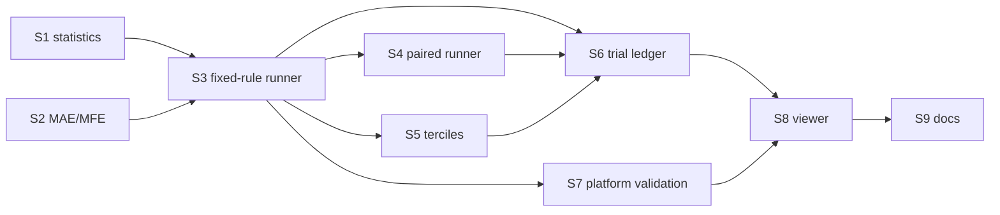

# ORB edge research: implementation plan

**Date:** 2026-10-31  
**Status:** Ready to implement  
**Audience:** the implementing agent, and the reviewer (the "High level
planner" session)  
**Implements:** Section 6 of `2026-10-31-orb-edge-research-plan.md`  
**Read first:** `2026-10-31-orb-edge-research-plan.md`, then Sections 4, 5 and
6 of `2026-10-31-backtest-research-north-star.md`

## 0. How to use this plan

This plan is written for an implementer who has not seen the design
discussion. Each stage lists the files to touch, the exact behaviour, the tests
to write, the commands to run and the "done when" conditions. Do the stages in
order. Do not add scope that is not written here; if something here is wrong or
impossible, stop and ask the reviewer rather than guessing.

### 0.1 Decisions already made (do not revisit)

- **Minimum edge of interest:** `0.05` R per trade, after costs.
- **Exploration set:** QQQ, AMZN, GOOGL, MSFT and TSLA, 2018-05 to 2024-12.
- **Confirmation set:** not chosen yet. Nothing in this plan may run on
  confirmation data. Code must accept any symbol list, but tests and examples
  use the exploration set or synthetic data only.
- **Final holdout:** 2025-01-01 to 2026-04-27, locked by
  `config/final_holdout.yaml`. Every new runner must enforce the lock.
- **Outcome labels:** every confirmatory number is reported as `supported`,
  `contradicted` or `underpowered` (north-star Section 4.5):

  | Outcome | Rule, for a confidence interval `[lo, hi]` and minimum edge `m` |
  | --- | --- |
  | supported | `lo > m` |
  | contradicted | `hi < m` |
  | underpowered | otherwise |

### 0.2 Global rules

1. **Branch and commits.** Work on your current branch. Commit once per stage
   (more is fine), push, and include this trailer in every commit message:
   `Co-authored-by: Copilot App <223556219+Copilot@users.noreply.github.com>`.
2. **Never change simulation results.** Do not edit `TRADE_DIGEST_FIELDS` in
   `vibe/research_pipeline/evidence.py`, `LEDGER_DIGEST_VERSION`, golden files
   under `tests/golden/`, or any existing ruleset YAML. New `Trade` fields are
   added *outside* the digest so every existing digest stays identical.
3. **Schema changes are forward-only.** Never edit an existing `_MIGRATION_N`
   string in `vibe/research_pipeline/storage/schema.py`. Add a new one.
4. **No trade-level data in experiment JSON.** `definition_json` and
   `result_json` are published to the remote read model.
   `vibe/research_pipeline/publishing.py::forbidden_payload_path` rejects keys
   such as `trades`, `fills`, `events` and `equity_points`. Results must be
   aggregates only: counts, means, intervals, histogram bins, per-year and
   per-symbol summaries. Per-trade and per-day series stay in `run_trades` and
   are computed by the local viewer.
5. **Tests use synthetic data.** This worktree has no market data. Build bars
   in memory or write small parquet files under pytest's `tmp_path`. Real-data
   runs are a manual step for the user (Section 11).
6. **No new dependencies.** There is no scipy. Use the standard library
   (`statistics.NormalDist`, `random.Random`) and the existing Student-t
   helpers `_student_t_cdf` and `_student_t_quantile` in
   `vibe/research_pipeline/reliability.py`. Import them; do not copy them.
7. **Deterministic.** Anything random takes an explicit integer seed and uses
   its own generator: `random.Random(seed)` in statistics code, or
   `numpy.random.default_rng(seed)` in the S7 bar generator. Never use the
   global `random` or `numpy.random` state.
8. **Type hints and docstrings** on every public function, matching the style
   of the surrounding module. Comment only what needs clarification.
9. **Do not stop** the viewer process that may already be running on port
   4178. Use another port for manual checks.

### 0.3 Commands

Python tests (PowerShell):

```powershell
$env:PYTHONDONTWRITEBYTECODE=1
python -m pytest <paths> -q -p no:cacheprovider
```

Full research-pipeline regression, run at the end of every stage:

```powershell
$env:PYTHONDONTWRITEBYTECODE=1
python -m pytest tests/unit/research_pipeline vibe/tests/backtester vibe/tests/research_journal -q -p no:cacheprovider
```

Viewer tests (Node 22.13 or newer):

```powershell
node --check tools\backtest-research-viewer\server.mjs
node --check tools\backtest-research-viewer\public\app.mjs
node --test tools\backtest-research-viewer\tests\
```

If a pre-existing test fails before your change, record it in the stage
report and do not fix it unless the stage requires it.

### 0.4 Review protocol

After each stage:

1. Run the stage's tests and the full regression above.
2. Commit and push.
3. Send a message to the reviewer session with:
   - the stage number and commit SHAs;
   - the list of changed files;
   - the test commands and their pass/fail counts;
   - any deviation from this plan and why;
   - anything you were unsure about.
4. Continue with the next stage. If the reviewer reports a blocking issue, fix
   it before you start the stage after the one you are on.

## 1. Stage overview

| Stage | Delivers | Research step it unblocks |
| --- | --- | --- |
| S1 | Statistics library: intervals, day-clustered SE, block bootstrap, MDE, outcome classifier, paired difference | All |
| S2 | MAE/MFE on every trade, schema v17, store and viewer read path | Steps 2, 4 |
| S3 | Fixed-rule study runner, single or multi-symbol | Steps 2, 6 |
| S4 | Paired comparison runner (baseline versus variant) | Steps 4, 8 |
| S5 | Session features and tercile breakdowns | Steps 3, 7 |
| S6 | Trial ledger and hypothesis cards | Steps 3 to 5 |
| S7 | Platform validation suite V3, V5, V6, V7 | Step 0 |
| S8 | Viewer panels for the new experiment kinds | Steps 0 to 4 |
| S9 | Documentation | All |



## 2. Stage S1: statistics library

**New file:** `vibe/research_pipeline/inference.py`  
**New test file:** `tests/unit/research_pipeline/test_inference.py`

### 2.1 Types

```python
@dataclass(frozen=True)
class Observation:
    """One trade's net R, tagged with the cluster it belongs to."""
    value_r: float
    cluster: str  # session date "YYYY-MM-DD"; trades on the same date share it


@dataclass(frozen=True)
class MeanEstimate:
    n: int                      # observations (trades)
    n_clusters: int             # distinct clusters (session dates)
    mean_r: float | None
    sd_r: float | None          # sample SD of observations
    se_iid_r: float | None      # sd / sqrt(n)
    se_cluster_r: float | None  # CR1 cluster-robust SE, Section 2.2
    design_effect: float | None # (se_cluster / se_iid) ** 2
    confidence_level: float
    ci_low_r: float | None      # t interval with n_clusters - 1 df on se_cluster
    ci_high_r: float | None
    bootstrap_ci_low_r: float | None   # day-block bootstrap percentile interval
    bootstrap_ci_high_r: float | None
    bootstrap_replicates: int
    bootstrap_seed: int | None


class Outcome(str, Enum):
    SUPPORTED = "supported"
    CONTRADICTED = "contradicted"
    UNDERPOWERED = "underpowered"
```

Add `def to_dict(self) -> dict[str, Any]` to `MeanEstimate` that returns
JSON-safe values (`None` for non-finite).

### 2.2 Functions and exact formulas

```python
def trade_net_r(trade: Any) -> float | None
```

`(trade.pnl - trade.commission) / trade.initial_risk`. Return `None` when
`initial_risk` is missing, zero or negative, or when `pnl` is missing. Treat a
missing `commission` as 0. This must match
`PerformanceAnalyzer._net_pnl(trade) / trade.initial_risk` in
`vibe/backtester/analysis/performance.py`; add a test that checks both agree
on the same trades.

```python
def trade_session_date(trade: Any) -> str
```

The entry time converted to `America/New_York`, formatted `YYYY-MM-DD`. Naive
datetimes are treated as already in exchange time. Raise `ValueError` if
`entry_time` is missing.

```python
def estimate_mean(
    observations: Sequence[Observation],
    *,
    confidence_level: float = 0.95,
    bootstrap_replicates: int = 0,
    bootstrap_seed: int | None = None,
) -> MeanEstimate
```

Drop non-finite values first. With `N` observations, `D` clusters, cluster
sums `S_d`, cluster sizes `n_d` and mean `x̄ = Σ S_d / N`:

- `sd_r = statistics.stdev(values)`, `se_iid_r = sd_r / sqrt(N)`.
- Cluster-robust (CR1) standard error of the mean:

  ```text
  se_cluster = sqrt( D / (D - 1) * Σ_d (S_d - n_d * x̄)^2 ) / N
  ```

- Interval: `x̄ ± t(1 - (1 - confidence_level) / 2, D - 1) * se_cluster`,
  using `_student_t_quantile`.
- Day-block bootstrap, only when `bootstrap_replicates > 0`: draw `D` clusters
  with replacement using `random.Random(bootstrap_seed)`, compute
  `Σ S / Σ n` for the draw, repeat, and take the percentile interval with the
  same interpolation as `reliability._percentile` (import it). Iterate
  clusters in sorted order before sampling so the result does not depend on
  input order.
- Edge cases: `N == 0` gives `mean_r None` and every other statistic `None`;
  `N == 1` or `D == 1` gives `mean_r` only; zero variance gives
  `se = 0` and `ci_low == ci_high == mean`.

Raise `ValueError` if `bootstrap_replicates > 0` and `bootstrap_seed is None`.

```python
def minimum_detectable_effect(
    se: float, *, alpha: float = 0.05, power: float = 0.80, two_sided: bool = True
) -> float
```

`(z(1 - alpha / 2) + z(power)) * se` for two-sided, `(z(1 - alpha) +
z(power)) * se` for one-sided, using `statistics.NormalDist().inv_cdf`.

```python
def required_observations(
    sd: float, mde: float, *, design_effect: float = 1.0,
    alpha: float = 0.05, power: float = 0.80, two_sided: bool = True
) -> int
```

`ceil(design_effect * ((z_a + z_b) * sd / mde) ** 2)`. Raise `ValueError` for
`mde <= 0` or `sd < 0`.

```python
def classify_outcome(ci_low: float | None, ci_high: float | None, *, min_edge_r: float) -> Outcome
```

The table in Section 0.1. `None` bounds give `UNDERPOWERED`.

```python
def paired_session_differences(
    baseline: Mapping[tuple[str, str], float],
    variant: Mapping[tuple[str, str], float],
    sessions: Iterable[tuple[str, str]],
) -> list[Observation]
```

Keys are `(symbol, session_date)`; values are the **sum** of net R for that
symbol and session (0 when the rule did not trade). For every key in
`sessions`, emit `Observation(variant.get(k, 0.0) - baseline.get(k, 0.0),
cluster=session_date)`. Raise `ValueError` if a key in `baseline` or
`variant` is missing from `sessions`, because that means the two rules were
not run on the same sessions.

```python
def session_r_totals(trades_by_symbol: Mapping[str, Sequence[Any]]) -> dict[tuple[str, str], float]
```

Sum `trade_net_r` per `(symbol, trade_session_date)`, skipping `None`.

```python
def cost_breakeven(trades: Sequence[Any]) -> dict[str, float | None]
```

Returns:

- `mean_net_r`: the extra cost per trade, in R, that would bring expectancy to
  zero (equal to the mean net R).
- `mean_commission_r`: mean of `commission / initial_risk`.
- `breakeven_extra_cost_bps`: `Σ net_pnl / Σ (entry_price * quantity) * 1e4`,
  the extra round-trip cost in basis points of entry notional that brings
  total net P&L to zero.

Slippage is already inside fill prices and cannot be separated here; say so
in the docstring.

```python
def split_alpha(total_alpha: float, n_tests: int) -> float
```

Bonferroni: `total_alpha / n_tests`. Raise `ValueError` for `n_tests < 1`.

### 2.3 Tests (`test_inference.py`)

1. **Known numbers.** For a sample with `n = 502` and `sd = 1.545` (build it
   from a fixed list, or test `minimum_detectable_effect(1.545 / sqrt(502))`
   directly): SE ≈ 0.0690 and two-sided MDE at 80% power ≈ 0.193 (north-star
   Section 5.2). Tolerance `1e-3`.
2. **Cluster SE equals IID SE when every cluster has one observation.** For
   any list of values with distinct clusters, `se_cluster_r ==
   pytest.approx(se_iid_r)` and `design_effect ≈ 1`.
3. **Cluster SE grows with within-day correlation.** Five symbols per day
   sharing an identical value per day: `design_effect ≈ 5` (tolerance 0.2 on
   1,000 days with seeded normal values).
4. **Hand-computed CR1.** Three clusters `{a: [1, 2], b: [0], c: [-1, 3]}`:
   compute the expected value by hand in the test (show the arithmetic in a
   comment) and compare.
5. **Interval coverage simulation.** 400 seeded replications of 300
   observations drawn from N(0.1, 1) in clusters of 3 with a shared day
   effect: the 95% interval covers 0.1 in 93% to 97% of replications.
6. **Bootstrap.** Same seed gives an identical interval; different seeds give
   a different one; input order does not change the result; missing seed
   raises.
7. **Edge cases.** Empty input, one observation, one cluster, NaN and inf
   values dropped, zero variance.
8. **`classify_outcome`.** One case per row of the table, both boundaries
   (`lo == m` is underpowered), and `None` bounds.
9. **`paired_session_differences`.** Missing trades count as 0; a key outside
   `sessions` raises; a variant identical to the baseline gives all zeros.
10. **`trade_net_r` agrees with `PerformanceAnalyzer`** on a few `Trade`
    objects, including zero `initial_risk`.
11. **`cost_breakeven`** on two hand-built trades.
12. **`required_observations`** round-trips with `minimum_detectable_effect`.

**Done when:** the new tests pass, the regression passes and
`inference.py` has no import of scipy, numpy random or the global `random`.

## 3. Stage S2: MAE/MFE on every trade

**Definitions.** For a trade with entry price `E`, initial risk per share
`r = |E - initial_stop_price|` and direction `s` (`+1` long, `-1` short):

- `mfe_r = max(0, max over observed prices p of s * (p - E) / r)`; the
  largest move in the trade's favour, in R.
- `mae_r = min(0, min over observed prices p of s * (p - E) / r)`; the
  largest move against it, in R, so it is zero or negative.

**Observed prices** for one trade:

1. the entry fill price `E`;
2. the high and low of every bar evaluated by `check_exits` while the position
   is open, except the bar on which a STOP or TP exit triggers;
3. on a STOP or TP exit bar, only the trigger level (`pos.stop_price` or
   `pos.take_profit`), because the path after the exit is irrelevant and the
   order of high and low inside the bar is unknown;
4. the exit fill price.

The fill bar itself is not included: the engine checks exits before it fills
entries on the same bar (`vibe/backtester/core/engine.py`, around L318 and
L487), and the part of that bar after the fill cannot be recovered from OHLC.
Record this limitation in the docstring.

Use the **final** `pos.entry_price` (it can change through `add_to_position`)
and `pos.initial_stop_price`. If `r == 0`, both values are `None`.

**Invariant:** `mae_r <= gross_r_per_share <= mfe_r`, where
`gross_r_per_share = s * (exit_price - E) / r`. Item 4 guarantees it.

### 3.1 Changes

1. `vibe/backtester/core/portfolio.py`
   - Add `max_price: float | None = None` and `min_price: float | None = None`
     to the `Position` dataclass (after `entry_commission`). Initialise both
     to the entry fill price in `open_position`.
   - Add a private `_observe_prices(pos, *prices)` helper that updates both.
   - In `check_exits`, after `_maybe_update_trailing_stop`:
     - TP or STOP exit: observe only the trigger level, then close.
     - otherwise: observe `bar.high` and `bar.low`, then apply the existing
       EOD logic.
     Keep the existing exit decisions **byte for byte**: observation must not
     change which exit happens or at what price.
   - In `close_position`, observe the exit fill price, compute `mae_r` and
     `mfe_r`, and pass them to `Trade`.
   - `close_open_positions_at_session_end` needs no extra observation because
     `check_exits` already saw that bar; confirm this by reading the code, and
     if it is not true, observe the bar there too.
2. `vibe/common/models/trade.py`: add
   `mae_r: Optional[float] = None` and `mfe_r: Optional[float] = None` with
   field descriptions. Do **not** add them to `TRADE_DIGEST_FIELDS`.
3. `vibe/research_pipeline/storage/schema.py`: add `_MIGRATION_17`:

   ```sql
   ALTER TABLE run_trades ADD COLUMN mae_r REAL;
   ALTER TABLE run_trades ADD COLUMN mfe_r REAL;
   ```

   Append `(17, _MIGRATION_17)` to `_MIGRATIONS` and set `SCHEMA_VERSION = 17`.
   Then search the tests for hard-coded version 16 (for example
   `grep -rn "16" tests/unit/research_pipeline | grep -i version`) and update
   only assertions that mean "the latest version".
4. `vibe/research_pipeline/storage/sqlite_store.py::record_trades`: insert
   `_opt_float(getattr(trade, "mae_r", None))` and the same for `mfe_r`.
   Trades loaded from older code without these attributes store `NULL`.
5. Any loader that rebuilds trades from `run_trades` (search for
   `FROM run_trades` in `vibe/`) returns the two new fields when present.
6. `tools/backtest-research-viewer/server.mjs::getRunTrades`: also return
   `commission`, `initial_risk`, `mae_r`, `mfe_r` and a server-computed
   `net_r` (`(pnl - commission) / initial_risk`, `null` when undefined). Use
   a column check (`PRAGMA table_info(run_trades)`) so databases without the
   new columns still load and return `null`.

### 3.2 Tests

New file `vibe/tests/backtester/test_trade_excursions.py`, using the synthetic
helpers in `vibe/tests/backtester/test_engine_execution.py` and
`test_entry_fill_policy.py` (`_make_orb_context`, `_frame`,
`_five_minute_bars`) or direct `PortfolioManager` calls:

1. **Long, EOD exit:** hand-built bars after entry with highs and lows chosen
   so `mfe_r = 1.5` and `mae_r = -0.4` exactly. Assert both.
2. **Long, STOP exit:** the stop bar's low is far below the stop. `mae_r`
   equals the stop level's R (about `-1`, adjusted for slippage at the exit
   fill), not the bar low.
3. **Short, TP exit:** sign conventions for shorts.
4. **Trailing stop:** a break-even trailing stop moves; `mae_r` still uses
   `initial_stop_price` for `r`.
5. **Exit decisions unchanged:** for a fixed synthetic dataset, the list of
   `(entry_time, exit_time, exit_price, exit_reason)` is identical with and
   without tracking. Do this by comparing against values captured before your
   change, written into the test as constants.
6. **Invariant:** across a seeded random synthetic run with many trades,
   `mae_r <= gross_r <= mfe_r` for every trade.
7. **Digest unchanged:** `trade_ledger_digest` of trades with `mae_r` set
   equals the digest of the same trades with `mae_r = None`.
8. `vibe/tests/backtester/test_backtest_determinism.py` still passes.

New file `tests/unit/research_pipeline/test_schema_v17.py`:

1. A fresh database reaches version 17 and `run_trades` has both columns.
2. A database created at version 16 (apply migrations 1 to 16 only, insert a
   run and trades) migrates to 17; old rows read back with `NULL` excursions;
   the frozen-run protection triggers still block deletes of protected rows.
3. `record_trades` round-trips `mae_r` and `mfe_r`.

Viewer, in `tools/backtest-research-viewer/tests/server.test.mjs`: the
existing v10 fixture still serves trades with `mae_r: null`; add a fixture
row with the new columns and assert `net_r`, `mae_r` and `mfe_r`.

**Done when:** all of the above pass, `tests/integration/test_golden_orb.py`
is unchanged (it skips without market data; that is expected), and no
existing digest test changes.

## 4. Stage S3: fixed-rule study runner

**Purpose:** evaluate **one predeclared rule** on every session in a date
range, for one or many symbols, with no parameter selection. Years are only a
stability view.

**New files:**

- `vibe/research_pipeline/fixed_rule.py`: library code.
- `scripts/run_fixed_rule_study.py`: command-line entry point.
- `vibe/research_pipeline/trials.py` with only the `TrialTag` model from
  Section 7.1, so S3 and S4 can store it. S6 adds the ledger.
- `tests/unit/research_pipeline/test_fixed_rule.py`.

### 4.1 Library API

```python
@dataclass(frozen=True)
class FixedRuleSpec:
    title: str
    ruleset_path: Path
    symbols: tuple[str, ...]          # sorted, de-duplicated, non-empty
    start: date
    end: date
    evidence_role: str                # "exploration" | "confirmation" | "platform_validation"
    min_edge_r: float = 0.05
    confidence_level: float = 0.95
    bootstrap_replicates: int = 1000
    bootstrap_seed: int = 20261031
    warmup_sessions: int = 60
    capital: float = 100_000.0
    trial: TrialTag | None = None


@dataclass(frozen=True)
class FixedRuleResult:
    spec: FixedRuleSpec
    per_symbol: dict[str, BacktestResult | None]
    errors: dict[str, str]
    summary: dict[str, Any]           # the result_json, Section 4.2


def run_fixed_rule_study(
    spec: FixedRuleSpec,
    run_symbol: Callable[[str], BacktestResult],
) -> FixedRuleResult
```

- `run_symbol` is injected so tests can pass a stub. The CLI passes a closure
  that builds a `BacktestEngine` from the ruleset and calls `run_segment` from
  `vibe/research_pipeline/segment_runner.py` with `warmup_sessions`, so
  warmup works the same way as in walk-forward studies.
- Use `run_universe` from `vibe/research_pipeline/universe.py` with a
  `static_declared(spec.symbols, rationale=...)` universe and
  `continue_on_error=True`. Each symbol has its own capital. A failed symbol
  makes the study `inconclusive` and is listed in `errors`.
- Validate: `start <= end`, `evidence_role` is one of the three values,
  `0 < confidence_level < 1`, `min_edge_r >= 0`.

### 4.2 `result_json` contents

All values are aggregates (rule 4 in Section 0.2). Keys:

```text
schema_version: 1
kind: "fixed_rule"
evidence_role
pooled:            MeanEstimate.to_dict() over all trades, clustered by session date
outcome:           classify_outcome(pooled CI, min_edge_r)  # "supported" | ...
min_edge_r
mde_r:             minimum_detectable_effect(pooled se_cluster_r, alpha = 1 - confidence_level)
per_day_mean_r:    mean of per-date summed R across symbols, and its SE (secondary view)
trades_per_year, r_per_year:   pooled; r_per_year = mean_r * trades_per_year
cost:              cost_breakeven(all trades)
by_symbol:         {symbol: {n, mean_r, ci_low_r, ci_high_r, outcome}}
by_year:           {year: {n, mean_r, ci_low_r, ci_high_r}}
by_exit_reason:    {reason: {n, share, mean_r}}
r_histogram:       {"edges": [...], "counts": [...]}   # fixed edges -3..+6 step 0.25, plus underflow and overflow bins
excursions:        {n_with_values, mean_mae_r, mean_mfe_r, share_mfe_ge_1r, share_mfe_ge_2r}
symbols_positive:  count of symbols with mean_r > 0
errors:            {symbol: message}
```

The histogram edges are fixed so histograms from different studies are
comparable. Key names must pass `forbidden_payload_path` (test this).

### 4.3 Recording

- The CLI opens the research store the same way
  `scripts/run_nested_walk_forward.py` does, and records each symbol's
  result through `BacktestRunSink` with
  `retention=RetentionProfile.DIAGNOSTIC`, so the trade ledger is kept.
- `store.start_experiment(title, definition)` where `definition` contains:
  `schema_version`, `kind: "fixed_rule"`, `evidence_role`, `ruleset_path`,
  the effective ruleset hash (`hash_effective_ruleset`), `symbols`, `start`,
  `end`, `warmup_sessions`, `capital`, `min_edge_r`, `confidence_level`,
  `bootstrap_replicates`, `bootstrap_seed` and `trial` (S6).
- Membership: `store.link_experiment_run(experiment_id, fold_index,
  candidate_id, role, run_id)` with `fold_index` = the symbol's position in
  the sorted symbol list, `candidate_id = "rule"`, and role mapped from
  `evidence_role`:

  | evidence_role | Membership role | Run `segment_role` |
  | --- | --- | --- |
  | exploration | `train` | `SegmentRole.TRAIN` |
  | platform_validation | `train` | `SegmentRole.TRAIN` |
  | confirmation | `test` | `SegmentRole.TEST` |

  The table's `CHECK` constraint allows only train, validation and test, and
  exploration data is in-sample data used to make choices, which is what
  `train` means. Document this mapping in the module docstring. Do not add a
  migration to change the constraint.
- When the sink reports a duplicate fingerprint, link the existing run ID.
- `store.finish_experiment(experiment_id, state, result_json)` with state
  `completed`, or `inconclusive` when any symbol failed or the pooled sample
  has fewer than 2 clusters.

### 4.4 Guards

- **Holdout:** before running, call `load_lock()` from
  `vibe/research_pipeline/holdout.py` and, for each symbol the lock
  `covers`, call `assert_within_dev` for `[start, end]`. A violation exits
  with code 2 before any engine run.
- **Confirmation needs registration:** if `evidence_role == "confirmation"`,
  require `--registration` and validate it. The existing
  `validate_registration_execution` is single-symbol and walk-forward
  specific; for now, refuse confirmation runs with a clear message
  ("confirmation runs need a multi-symbol registration; not implemented yet")
  and add a test for the refusal. Confirmation registration is a later stage,
  after the confirmation set is chosen.
- **Dataset manifest:** optional `--dataset-manifest`; when given, verify it
  with `verify_materialized_dataset` in
  `vibe/research_pipeline/datasets/cache.py` and store its hash in the
  definition.

### 4.5 CLI

```text
python scripts/run_fixed_rule_study.py
  --title TEXT                    (required)
  --ruleset PATH                  (default vibe/rulesets/orb_production.yaml)
  --symbols QQQ,AMZN,...          (required)
  --start YYYY-MM-DD --end YYYY-MM-DD   (required)
  --evidence-role exploration|platform_validation|confirmation   (required)
  --data-dir PATH  --research-db PATH
  --capital FLOAT  --warmup-sessions INT
  --min-edge-r FLOAT (0.05)  --confidence-level FLOAT (0.95)
  --bootstrap-replicates INT (1000)  --bootstrap-seed INT
  --programme TEXT --trial-family TEXT --trial-label TEXT   (S6)
  --dataset-manifest PATH  --registration PATH
  --no-record                     (compute and print only)
```

It prints a short text summary: pooled n, mean, CI, outcome, MDE, by-year
table and errors.

### 4.6 Tests

Use a stub `run_symbol` that returns an object with `.trades`, `.overall`
and `.equity` shaped like `BacktestResult` (see how
`tests/unit/research_pipeline` builds fake results for the walk-forward
tests and reuse those helpers), and an in-memory or `tmp_path` research store.

1. Pooled statistics equal `estimate_mean` over hand-built trades from two
   symbols with overlapping dates (clusters shared across symbols).
2. `by_year`, `by_symbol`, `by_exit_reason`, histogram counts (including
   underflow and overflow) and `symbols_positive` match hand counts.
3. A failing symbol produces `errors`, state `inconclusive`, and the other
   symbols are still summarised.
4. Holdout: a range ending 2025-02-01 for QQQ raises before `run_symbol` is
   called (assert the stub was never called).
5. `evidence_role="confirmation"` is refused.
6. `result_json` passes `forbidden_payload_path(...) is None` and
   `json.dumps(..., allow_nan=False)`.
7. Recording: runs are linked with the role mapping in Section 4.3; the
   experiment's definition and result read back; a second identical study
   links the same run IDs (duplicate fingerprints).
8. Determinism: two runs with the same inputs and seed give identical
   `result_json`.
9. CLI smoke test: run `main([...])` with `--no-record` against a `tmp_path`
   data directory holding a small synthetic parquet file (copy the parquet
   layout used by an existing test; search `to_parquet` under `vibe/tests`
   and `tests/`). Assert exit code 0 and that the summary mentions the outcome.

**Done when:** tests pass and the CLI runs end to end on synthetic parquet.

## 5. Stage S4: paired comparison runner

**Purpose:** compare a variant rule against the baseline **on the same
symbols and sessions**, using per-session differences, which are far less
noisy than comparing two separate expectancies.

**New files:** `vibe/research_pipeline/paired.py`,
`scripts/run_paired_comparison.py`,
`tests/unit/research_pipeline/test_paired.py`.

### 5.1 Behaviour

```python
@dataclass(frozen=True)
class PairedSpec:
    title: str
    baseline_ruleset: Path
    variant_ruleset: Path
    lever: str                         # e.g. "exit.trailing_stop", free text
    symbols: tuple[str, ...]
    start: date
    end: date
    evidence_role: str
    min_edge_r: float = 0.05           # per trade, converted below
    confidence_level: float = 0.95
    bootstrap_replicates: int = 1000
    bootstrap_seed: int = 20261031
    warmup_sessions: int = 60
    capital: float = 100_000.0
    trial: TrialTag | None = None


def run_paired_comparison(
    spec: PairedSpec,
    run_baseline: Callable[[str], BacktestResult],
    run_variant: Callable[[str], BacktestResult],
    sessions_for: Callable[[str], Sequence[str]],
) -> PairedResult
```

- `sessions_for(symbol)` returns the graded session dates (`YYYY-MM-DD`) for
  that symbol in `[start, end]`. The CLI implements it from the session
  calendar used by `segment_runner.py`, intersected with dates present in the
  data. Tests pass a fixed list.
- Unit of analysis: `(symbol, session_date)`. Per-session net R totals come
  from `session_r_totals`; differences from `paired_session_differences`,
  clustered by date. Sessions where neither rule trades contribute 0.
- The estimate is the **mean difference in R per symbol-session**. Convert
  the per-trade minimum edge to this unit:
  `min_edge_per_session = min_edge_r * baseline_trades / n_symbol_sessions`.
  Store both numbers in the result.
- Holdout and confirmation guards: as in S3.
- Recording: one experiment with `kind: "paired_comparison"`; baseline runs
  linked with `candidate_id = "baseline"`, variant runs with
  `candidate_id = "variant"`, same `fold_index` per symbol, roles as in S3.

### 5.2 `result_json`

```text
schema_version: 1
kind: "paired_comparison"
lever, evidence_role
n_symbol_sessions, n_dates
difference:          MeanEstimate.to_dict() of per-session differences
difference_per_year_r: mean difference * sessions per year per symbol * n_symbols
min_edge_per_session_r, outcome, mde_per_session_r
baseline:            pooled per-trade MeanEstimate, trades, trades_per_year
variant:             same
sessions_changed:    count of sessions where the difference is non-zero
by_year:             {year: {n_sessions, mean_diff_r, ci_low_r, ci_high_r}}
by_symbol:           {symbol: {n_sessions, mean_diff_r, ci_low_r, ci_high_r}}
```

### 5.3 Tests

1. Identical baseline and variant stubs: every difference is 0, interval
   `[0, 0]`, outcome contradicted for `min_edge > 0`.
2. Variant adds a known `+0.2R` to every baseline trade: mean difference
   equals `0.2 * trades / sessions` exactly.
3. Variant skips half the trades (a filter): difference equals minus the
   skipped trades' R per session; `sessions_changed` counts them.
4. A trade on a date not in `sessions_for` raises (rules not run on the
   same sessions).
5. **Paired is tighter than unpaired:** with seeded noise shared between the
   two rules plus a small planted difference, the paired interval width is
   less than half of the width of the difference of two independent
   intervals. This test documents why pairing matters.
6. Guards, JSON safety, recording and determinism as in S3.
7. CLI smoke test with two small ruleset files in `tmp_path` that differ in
   one field.

## 6. Stage S5: session features and tercile breakdowns

**Purpose:** show expectancy by market condition (low, middle, high tercile)
for the candidate variables in research Step 3. Results are labelled
**diagnostic**. They choose hypotheses; they never confirm them.

### 6.1 Session features

**New file:** `vibe/research_pipeline/session_features.py`.

The existing `regime_research/features.py` mixes daily and intraday logic,
and several of its features use the current bar's close. Do not reuse it for
this. Build a small, explicit feature table instead:

```python
def build_session_features(
    bars: pd.DataFrame,          # intraday OHLCV, tz-aware index in America/New_York
    *,
    or_minutes: int = 5,
) -> pd.DataFrame                # index: session date (YYYY-MM-DD), columns below
```

Every value must be known by the **end of the opening range** on that
session. Definitions, where "prior sessions" means completed sessions before
today:

| Column | Definition |
| --- | --- |
| `gap_pct` | `(today's first open - prior session's last close) / prior close * 100` |
| `abs_gap_pct` | `abs(gap_pct)` |
| `or_width_atr` | `(OR high - OR low) / ATR14`, where ATR14 is the 14-session average true range of prior sessions' daily bars |
| `atr_pctile` | percentile rank of prior-session ATR14 among the 252 prior sessions (needs 252) |
| `rel_open_volume` | today's OR-window volume / mean OR-window volume over the 20 prior sessions (needs 20) |
| `prior_trend_20d_pct` | `(prior close - close 21 sessions ago) / close 21 sessions ago * 100` |

The opening range is the bars with timestamps in `[09:30, 09:30 + or_minutes)`.
Values that lack enough history are `NaN`.

### 6.2 Breakdown

**New file:** `vibe/research_pipeline/conditional.py`.

```python
def tercile_breakdown(
    trades_by_symbol: Mapping[str, Sequence[Any]],
    features_by_symbol: Mapping[str, pd.DataFrame],
    variable: str,
    *,
    confidence_level: float = 0.95,
    min_edge_r: float = 0.05,
) -> dict[str, Any]
```

- Join each trade to its symbol's feature row by `trade_session_date`. Trades
  with a `NaN` value are counted in `n_missing` and excluded.
- Tercile cutoffs are the 1/3 and 2/3 quantiles of the variable **over the
  trades in this study** (pooled across symbols). Store the cutoffs.
- For each tercile (`low`, `mid`, `high`): `estimate_mean` clustered by date,
  plus `by_year` and `by_symbol` means and counts.
- `interaction`: high minus low, with
  `se = sqrt(se_high^2 + se_low^2)` and a normal-approximation interval. This
  is approximate because the two terciles can share dates; say so in the
  output (`"approximate": true`).
- `monotonic`: `"increasing"`, `"decreasing"` or `"none"` from the three
  tercile means.
- `consistency`: the share of years, and the share of symbols, in which
  `high - low` has the same sign as the pooled interaction.
- Always include `"label": "diagnostic"`.

### 6.3 Runner

Extend `scripts/run_fixed_rule_study.py` with
`--condition VARIABLE` (repeatable). For each variable the study adds a
`conditions.{variable}` block to `result_json`. The CLI loads bars through
the same loader the engine uses, calls `build_session_features` with the
ruleset's OR duration, and calls `tercile_breakdown`. Each variable counts as
one trial in S6.

### 6.4 Tests

`tests/unit/research_pipeline/test_session_features.py`:

1. **Causality by truncation.** For a synthetic 300-session dataset, compute
   features; then, for 20 random sessions, replace every bar after the OR end
   of that session (and all later sessions) with random values and recompute.
   That session's feature row must be identical. This is the key test; do
   not weaken it.
2. Hand-computed values for `gap_pct`, `or_width_atr` and `rel_open_volume`
   on a small dataset.
3. Warm-up rows are `NaN`; `or_minutes=15` uses three 5-minute bars.

`tests/unit/research_pipeline/test_conditional.py`:

1. **Planted interaction.** Trades whose R is `+0.3` when the variable is
   above its median and `-0.1` below: `monotonic == "increasing"` and the
   interaction interval excludes 0.
2. **No interaction.** R independent of the variable (seeded noise): the
   interaction interval contains 0 in at least 90 of 100 seeded
   replications.
3. Missing values are counted, cutoffs stored, JSON is safe.

## 7. Stage S6: trial ledger and hypothesis cards

### 7.1 Trial tags

**File:** `vibe/research_pipeline/trials.py` (created in S3 with only
`TrialTag`; S6 adds its tests, CLI flags and the ledger).

```python
class TrialTag(BaseModel):  # pydantic, frozen
    programme: str          # e.g. "orb_edge_2026"
    phase: Literal["exploration", "confirmation", "platform_validation"]
    family: Literal["baseline", "condition", "enhancement", "validation"]
    label: str              # e.g. "rel_open_volume" or "break_even_trail_1r"
    hypothesis_ids: tuple[str, ...] = ()
    n_trials: int = 1       # variables or variants examined in this experiment
```

- S3, S4 and S5 runners store `trial` in `definition_json`. S5 sets
  `n_trials` to the number of `--condition` variables.
- CLI flags: `--programme`, `--trial-family`, `--trial-label`,
  `--hypothesis-id` (repeatable). When `--programme` is given, the tag is
  required; when it is absent, no tag is stored.

Add to the store (`sqlite_store.py`):

```python
def trial_counts(self, programme: str) -> dict[str, Any]
```

It returns totals by phase and family, summing `n_trials`, using
`json_extract(definition_json, '$.trial.programme')` on
`research_experiments`. No schema change. Include experiments in every state,
because a failed or abandoned trial still counts.

Add a script `scripts/show_trial_ledger.py --programme X --research-db PATH`
that prints the table.

### 7.2 Hypothesis cards

**New file:** `vibe/research_pipeline/hypothesis_cards.py` and a folder
`config/research/hypothesis_cards/` with a `README.md` and one example card
`EXAMPLE.yaml` (status `example`, clearly not a real hypothesis).

```python
class HypothesisCard(BaseModel):
    card_id: str                   # "H1", "H2", "H3"
    journal_id: str | None         # matching research_journal id, e.g. "HYP-005"
    programme: str
    claim: str
    rule: str                      # ruleset path or description
    prediction: str
    min_edge_r: float = 0.05
    alpha_share: float             # e.g. 0.05 / 3
    analysis: str                  # the exact analysis, e.g. "fixed_rule pooled, day-clustered, two-sided"
    expected_n_trades: int
    expected_sd_r: float
    expected_design_effect: float = 1.0
    kill_criteria: list[str]
    confirmation_data: str
    status: Literal["example", "draft", "registered", "supported", "contradicted", "underpowered"]

    def planned_mde_r(self, power: float = 0.80) -> float
```

- `planned_mde_r` uses `minimum_detectable_effect` with
  `se = expected_sd_r * sqrt(expected_design_effect / expected_n_trades)` and
  `alpha = alpha_share`.
- `load_cards(directory) -> list[HypothesisCard]` validates that the sum of
  `alpha_share` over cards with the same programme and status `registered`
  is at most 0.05.
- Do **not** write H1 to H3 cards. They are written in research Step 5 after
  exploration. Do not change `vibe/research_journal`.

### 7.3 Tests

1. `trial_counts` sums `n_trials` across experiments by phase and family,
   ignores other programmes, includes failed experiments.
2. Runners store the tag; a run without `--programme` stores none.
3. `HypothesisCard.planned_mde_r` matches a hand calculation.
4. `load_cards` rejects a set whose registered alpha shares exceed 0.05.
5. The example card loads.

## 8. Stage S7: platform validation suite

**Purpose:** research Step 0. Prove that the platform reports "no edge" when
there is none, and finds an edge of known size at the predicted rate.

**New files:**

- `vibe/research_pipeline/validation_suite/synthetic.py`: bar generators.
- `vibe/research_pipeline/validation_suite/suite.py`: V6 and V7 drivers.
- `scripts/run_platform_validation.py`.
- `tests/platform_validation/` with `test_v3_hand_sessions.py`,
  `test_v5_lookahead.py`, `test_v6_null.py` and `test_v7_planted.py`.

### 8.1 Synthetic bars

```python
def tick_walk_sessions(
    *, n_sessions: int, seed: int, start: date = date(2019, 1, 2),
    bar_minutes: int = 5, start_price: float = 100.0, tick: float = 0.01,
    steps_per_bar: int = 225, up_probability_with_trend: float = 0.5,
) -> pd.DataFrame
```

- Weekday sessions from 09:30 to 16:00 America/New_York, using the same
  column names, index type and timezone as the parquet files the engine reads
  (copy the layout from an existing parquet-writing test). Volume can be a
  constant.
- The price is a **tick-level random walk**: every step moves exactly one
  tick up or down. Each bar has `steps_per_bar` steps; its open is the
  previous bar's close, its high and low are the max and min of its path, and
  its close is the last step. Because the path moves one tick at a time, it
  passes through every price between its low and high, so a stop or entry
  trigger inside the bar's range is a price that really traded. A coarser
  generator would make fills at the trigger price optimistic and bias the
  null test.
- Overnight, the next session opens at the previous close plus a random
  number of ticks (for example normal with SD 20 ticks, rounded).
- Each session draws a direction `d` of `+1` or `-1` with probability 1/2.
  A step goes in direction `d` with probability `up_probability_with_trend`.
  With `0.5` the price is a martingale.
- Generate with `numpy.random.default_rng(seed)`, vectorised per session.

**Why a martingale is the right null:** with zero costs, any strategy whose
entries, stops and exits are decided from past prices, and filled at prices
that really traded, has zero expected gross P&L on a martingale. Net R is
then zero on average, so a correct platform should report "supported" (lower
bound above 0) in about `alpha / 2` of studies. If the engine fills a stop at
its level after the bar has already gapped through it, that is an optimistic
fill, and V6 will show it as excess false positives.

### 8.2 V6: null calibration

`run_null_calibration(n_studies, n_sessions, seed, ruleset_path, confidence_level=0.95)`:

1. For each study `i`, generate `tick_walk_sessions(seed = seed + i)` with
   `up_probability_with_trend = 0.5`,
   write it as a parquet file in a temporary directory, and run the real
   `BacktestEngine` with the **production ORB ruleset**, commission 0 and
   slippage 0. Use the engine's existing configuration options for this; if
   commission or slippage cannot be set to zero from the ruleset or the
   engine arguments, stop and ask the reviewer.
2. Compute `estimate_mean` on the trades and record whether the interval's
   lower bound is above 0 (false positive), the interval covers 0, and the
   mean.
3. Report: false-positive rate with a Wilson interval, coverage rate, mean of
   means, and number of trades per study.

**Expected:** false-positive rate near 2.5% (one side of a 95% interval);
coverage near 95%. A clearly higher false-positive rate is a **finding about
the platform** (for example, optimistic entry fills), not a test to tune.
Report it to the reviewer; do not change the engine in this stage.

### 8.3 V7: planted edge

`run_planted_edge(n_studies, n_sessions, seed, up_probability_with_trend=0.52, truth_sessions=20000)`:

1. Estimate the "true" expectancy once from one very long run
   (`truth_sessions`) with the same `up_probability_with_trend`. Pick the
   default so the truth is clearly positive but power is moderate (roughly
   40–80%); report the value used.
2. For each of `n_studies` independent shorter studies, record the interval
   and whether it lies above 0 (detected) and covers the truth.
3. Predicted power: from the truth and the mean SE across studies,
   `P(detect) = 1 - Φ(z(1 - α/2) - truth / se)`.
4. Report: truth, detection rate versus predicted power, coverage of the
   truth.

**Expected:** coverage near 95%; detection rate within about 10 points of
predicted power.

### 8.4 V3: hand-verified sessions

Five synthetic single-session datasets, each with a docstring stating the
expected trade by hand:

1. Gap up, long breakout, end-of-day exit.
2. Gap down, short breakout, stop exit.
3. No breakout: no trade.
4. Breakout then stop on the same bar as a new high (ambiguous bar): the
   resolution follows `intrabar_exit_resolution`.
5. A session that breaks out after the 15:00 entry cutoff: no trade.

Assert entry price, exit price, exit reason, net R, `mae_r` and `mfe_r`
exactly. Some of these may already be covered by
`vibe/tests/backtester/test_engine_execution.py`; reuse its helpers, but keep
the five cases together in this file so the suite is self-contained.

### 8.5 V5: look-ahead canaries

1. `assert_decision_features_are_causal` in
   `vibe/research_pipeline/features/registry.py` rejects a diagnostic
   feature.
2. A truncation test on `build_session_features` (S5 test 1) is imported or
   repeated here so the suite lists it.
3. A deliberately cheating strategy, defined only in the test, that peeks at
   the session's last close to choose direction, run on the V6 null data,
   shows a large positive mean with the interval above 0. This demonstrates
   that the null test would catch look-ahead. Keep it in the test module, not
   in `vibe/`.

### 8.6 Tests and the real run

- Tests run small versions: V6 with 20 studies of 120 sessions, V7 with 20
  studies, and assert only plumbing and loose bounds (for example, V6
  false-positive count at most 4 of 20). Mark any test slower than 30 seconds
  with `@pytest.mark.slow` if that marker exists in the repository's pytest
  configuration; otherwise keep the sizes small.
- `scripts/run_platform_validation.py --suite v6|v7|all --studies 200
  --sessions 500 --seed 1 --research-db PATH` runs the full version and
  records one experiment per suite with `kind: "platform_validation"`,
  `evidence_role: "platform_validation"` and the report in `result_json`.
  These are the reference experiments for research Step 0.

## 9. Stage S8: viewer panels

**Where:** `tools/backtest-research-viewer` only. The Next.js dashboard in
`apps/operational-metrics-dashboard` is the remote publication UI and must
not show trade-level data; do not change it in this plan.

Keep the existing security model: allow-listed GET routes in `routeApi`,
`hasTable` and column checks for older schemas, bounded rows, and
`redactSecrets` on every JSON payload.

### 9.1 New endpoints

1. `GET /api/experiments/:id/r-series`
   - For every run linked to the experiment, read `run_trades` and compute
     net R per trade (as in S2).
   - Group by `candidate_id`, then by session date (the date part of
     `entry_time` in America/New_York; use the same rule as
     `trade_session_date`).
   - Return, per candidate, an array of `{date, r, cumulative_r,
     drawdown_r}` where `r` is the date's summed R across symbols.
   - At most `MAX_DETAIL_ROWS` dates per candidate; if more, set
     `truncated: true`.
2. `GET /api/experiments/:id/excursions`
   - Rows of `{candidate_id, symbol, net_r, mae_r, mfe_r, exit_reason}` for
     trades with non-null excursions.
   - If more than `MAX_DETAIL_ROWS`, take a deterministic even stride and
     set `sampled: true` with the total count.

Both return 404 for an unknown experiment and an empty payload with
`available: false` when `run_trades` lacks the needed columns.

### 9.2 Panels in the experiment detail view

Render by `definition.kind`. Existing walk-forward experiments must look
exactly as they do now.

- **`fixed_rule`:**
  - outcome badge (supported, contradicted, underpowered) with the interval,
    the minimum edge line and the MDE;
  - cumulative R and drawdown in R from `r-series`;
  - R histogram from `result_json.r_histogram`;
  - year bars with intervals; symbol bars with intervals;
  - exit-reason table;
  - MAE/MFE scatter from `excursions`, coloured by exit reason;
  - cost box: mean net R, break-even extra cost in basis points;
  - evidence-role banner: "Exploration: cannot confirm" for exploration
    and platform validation.
- **`paired_comparison`:** difference badge and interval against the
  per-session minimum edge, cumulative R of both candidates on one chart, the
  difference by year and by symbol.
- **Conditions** (inside `fixed_rule` when present): one small table per
  variable with low, mid and high rows (n, mean, interval), the interaction
  and its interval, the monotonic flag and the consistency shares, under a
  "Diagnostic" label.
- **`platform_validation`:** false-positive rate or detection rate against the
  expected value, with a pass or review badge.
- **Trial counter:** if `definition.trial` is present, show the programme and
  the programme's total trials (add
  `GET /api/programmes/:programme/trials`, computed with the same query as
  `trial_counts`).

Use the existing SVG chart approach in `public/run-charts.mjs`. Put pure view
logic (data to chart model, badge choice, formatting) in testable modules in
`public/`, as `experiment-view.mjs` does now.

### 9.3 Tests

- `server.test.mjs`: fixtures for a `fixed_rule` and a `paired_comparison`
  experiment with linked runs and trades; endpoint shapes; truncation and
  sampling flags with a small row bound; 404s; the v10 fixture still works
  and returns `available: false`.
- A new `experiment-kinds.test.mjs` (or extend `experiment-view.test.mjs`):
  badge choice for each outcome, histogram model, cumulative R and drawdown
  arithmetic on a hand-built series, conditions table model, and that an
  unknown `kind` falls back to the existing view.
- Manual check: start the viewer on port 4179 against a database produced by
  the S3 and S4 CLI smoke tests and take a screenshot of each panel for the
  stage report.

## 10. Stage S9: documentation

1. `tools/backtest-research-viewer/README.md`: the new panels and endpoints.
2. `docs/backtest-research-summaries/2026-10-18-backtest-handoff.md`: add
   the new CLIs and the schema version 17.
3. `docs/backtest-research-summaries/2026-10-31-orb-edge-research-plan.md`
   Section 6: mark each capability as implemented, with the module name.
4. A short "How to run research Steps 0, 2, 3 and 4" section in the research
   plan, with the exact commands from Section 11.

## 11. After implementation: the first real runs (for the user)

These need market data (`BACKTEST__DATA_DIR`) and are not part of the
implementation. They are listed so the implementer can make the CLIs fit
them.

```powershell
# Step 0: platform validation
python scripts/run_platform_validation.py --suite all --studies 200 --sessions 500 --seed 1 --research-db <db>

# Step 2: baseline on the exploration set
python scripts/run_fixed_rule_study.py --title "ORB baseline, exploration set" `
  --ruleset vibe/rulesets/orb_production.yaml --symbols QQQ,AMZN,GOOGL,MSFT,TSLA `
  --start 2018-05-01 --end 2024-12-31 --evidence-role exploration `
  --programme orb_edge_2026 --trial-family baseline --trial-label orb_production `
  --research-db <db>

# Step 3: conditions
python scripts/run_fixed_rule_study.py ... --condition rel_open_volume --condition abs_gap_pct `
  --condition or_width_atr --condition atr_pctile --condition prior_trend_20d_pct `
  --trial-family condition --trial-label step3_conditions

# Step 4: one lever at a time
python scripts/run_paired_comparison.py --title "Break-even trail vs baseline" `
  --baseline-ruleset vibe/rulesets/orb_production.yaml --variant-ruleset <variant.yaml> `
  --lever exit.trailing_stop --symbols QQQ,AMZN,GOOGL,MSFT,TSLA `
  --start 2018-05-01 --end 2024-12-31 --evidence-role exploration `
  --programme orb_edge_2026 --trial-family enhancement --trial-label break_even_trail
```

## 12. Out of scope

- Choosing the confirmation set (research Step 1) and multi-symbol
  registration for confirmation runs.
- Filters as strategy rules (needed for H2 in research Step 7). They are
  added once Step 3 has picked at most two conditions.
- The final holdout run, deflated Sharpe ratio and probability of
  backtest overfitting.
- Any change to the Next.js dashboard or remote publication schema.
