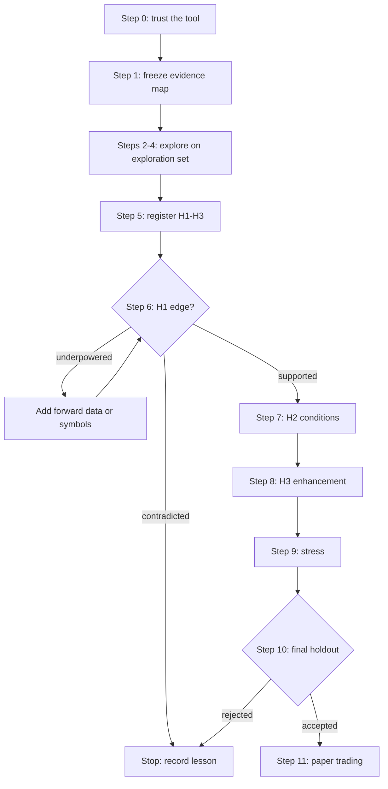

<!-- taskboard
{"id":"orb-plan","title":"ORB research programme and gates","projects":["orb-research"],"status":"current","kind":"plan","reviewed":"2026-11-14"}
-->
# ORB edge research plan

**Date:** 2026-10-31  
**Status:** Plan only; no new results in this document  
**Audience:** Bloom, and any agent running ORB research  
**Read with:** `2026-10-31-backtest-research-north-star.md` (Sections 5,
6.5 and 6.6), `2026-10-18-backtest-handoff.md`

## 1. Goal

Find out, with honest evidence, whether the opening range breakout (ORB)
strategy has a tradable edge. The plan answers four questions in order:

| # | Question | Answered by |
| --- | --- | --- |
| Q1 | Is there an edge? | Step 6 |
| Q2 | How large is it? | Step 6 |
| Q3 | In which market conditions does it hold? (the pre-screen or filter) | Steps 3 and 7 |
| Q4 | How can it be made larger? | Steps 4 and 8 |

Every confirmatory answer is one of **supported**, **contradicted** or
**underpowered**. "Not shown" is never reported as "shown absent".

The plan follows one principle: **explore on one set of data, confirm on
another, and decide what to confirm before looking at the confirmation
data.**

**Strategy objective added 2026-11-14:** pursue "positive net returns with
less drawdown, limited overnight exposure, and returns that complement
buy-and-hold", as recorded in the
[north star](2026-10-31-backtest-research-north-star.md#orb-research-objective-decision-2026-11-14).
This supplements the edge questions above; it does not replace the existing
+0.05R meaningful-edge threshold or claim that the current rule meets the goal.

Before the next study, predeclare how each part will be evaluated:

| Objective | Required comparison or measurement |
| --- | --- |
| Positive net returns | Net expectancy with uncertainty, net dollars per all symbol-sessions including no-trade sessions, trade frequency and annual/ticker stability; preserve modelled commissions and slippage and disclose unmodelled costs |
| Less drawdown | Drawdown depth and duration versus the unchanged stack and buy-and-hold on common dates, with a declared capital, exposure/leverage and risk-comparison basis; daily closed-trade drawdown is not intraday mark-to-market risk |
| Limited overnight exposure | Verify entries/exits and any positions carried across session close; do not infer safety from an EOD exit rule alone |
| Complement buy-and-hold | Compare aligned daily returns, downside co-movement and exposure; a combined allocation needs fixed weights, a risk/capital budget and cash treatment before testing, not simply a sum of independent accounts |

Use cash as a reference when explaining bear-year outperformance. Disclose
benchmark dividends/fees and the risk-free or cash-yield assumption; the
current dashboard benchmark is a source-price ratio, not an explicitly
dividend-credited total-return series. Higher Sharpe, lower drawdown or a
beneficial combination is not established by the annual return comparison.
Numerical drawdown/complementarity acceptance thresholds remain to be agreed
before execution, rather than chosen after seeing results.

## 2. Evidence map

Data has two roles. Exploration data can be reused freely but can never
confirm. Confirmation data is spent the first time its results are viewed.

| Data | Role | Why |
| --- | --- | --- |
| QQQ, 2018-05 to 2024-12 | **Exploration** | Used for pipeline validation, legacy ORB experiments (HYP-001 to HYP-004) and two walk-forward studies. Reusable for any exploration. It can only confirm a hypothesis never examined on it |
| AMZN, GOOGL, MSFT, TSLA, 2018-05 to 2024-12 | **Exploration** (decided 2026-10-31) | ORB results were viewed once: the P5b universe check ran the ORB rule on all five symbols over a window of about 124 trades each and reported +0.44R to +0.78R (`2026-09-09-backtest-pipeline-implementation-plan.md`, "Cross-sectional result from P5b"). They are also configured for live trading |
| 25 single stocks, 2018-05 to 2024-12, never run through ORB (frozen 2026-11-01, see Step 1) | **Confirmation set** | Never examined for ORB, so it can confirm hypotheses registered before its results are viewed |
| All symbols, 2025-01-01 to 2026-04-27 | **Final holdout** | Locked by `config/final_holdout.yaml`; read once at the end |
| All symbols, after 2026-04-27 | **Forward evidence** | Accrues at about 250 sessions per symbol per year; used for shadow and paper trading |

Notes:

- `config/final_holdout.yaml` already locks 2025-01-01 to 2026-04-27 for AMZN,
  GOOGL, MSFT, QQQ and TSLA.
- Most research used only QQQ, but the P5b check means AMZN, GOOGL, MSFT and
  TSLA are not fully fresh. Viewing one strongly positive window is enough to
  bias which hypotheses look attractive. **Decision (2026-10-31):** explore on
  all five and confirm on tickers never run through ORB. The confirmation
  tickers were frozen in Step 1 on 2026-11-01.
- Five exploration symbols are a strength: a Step 3 or Step 4 pattern that
  appears on QQQ but not on the other four is probably noise.
- Every symbol added to the confirmation set should be added to the holdout
  lock **before** any of its data is run, so the final holdout covers the whole
  universe.
- Legacy findings on QQQ, such as "no take-profit" (HYP-003) and the
  break-even trailing stop (HYP-004), are **exploration findings**. They may
  shape hypotheses, but QQQ cannot confirm them.

## 3. Steps

Each step lists its purpose, data, procedure, outputs and the gate before the
next step. Steps 0 to 5 never touch confirmation data.

### Step 0: Trust the tool

**Purpose:** prove the platform measures edges correctly before using it to
measure one.  
**Data:** synthetic data and QQQ.

**Procedure** (north-star Section 6.3):

- V3 hand-verified QQQ sessions: gap up, gap down, no breakout, stop hit,
  end-of-day exit.
- V5 strategy-level look-ahead canary.
- V6 random-entry null across many seeds.
- V7 planted edge of known size.

**Outputs:** the reliability policy's measured false-positive rate and its
planted-edge detection rate.

**Gate:** the false-positive rate is near 5% or below, and detection matches
the power predicted in north-star Section 5. Otherwise fix the platform first.

**V6/V7 results (2026-11-01, 200 studies × 500 sessions, seed 1):**

- V6 (experiment `01a1995d-81b6-7264-a192-55f462401160`, serial, 109.8 min):
  0/200 false positives (Wilson 0–1.9%), coverage 95.5%, mean of means
  +0.008R. Pass.
- V7 (experiment `01a19a1b-874c-7c9a-88db-09848d437ced`, 10 workers,
  12.3 min, truth pooled from 40 × 500 sessions): truth +0.256R ± 0.024
  (matches the S7 calibration of ~0.26R), coverage of truth 95.0%, detection
  28.5% vs predicted 40.6%. Pass under the suite tolerance (±0.15), but the
  detection rate is below prediction: the Wilson interval for 57/200 is about
  23–35%. The gap is in the conservative direction (the platform misses some
  real edges and does not over-claim). Likely causes are uncertainty in the
  truth (±0.024R moves the predicted power across ~34–47%) and skewed R
  outcomes, where studies with high means also have wider SEs. It is not
  blocking, but it means real-data power estimates should be treated as
  optimistic by about 10 points.

### Step 1: Freeze the evidence map

**Purpose:** decide what counts as confirmation data before seeing anything.  
**Data:** metadata only, with no strategy runs.

**Procedure:**

1. List every ticker with local intraday history, its date range and data
   quality: missing sessions, splits, timestamps.
2. Apply a selection rule written in advance, for example: average daily dollar
   volume above a threshold, price above $10, at least 95% session coverage
   2018 to 2024. Decide ETFs, single stocks, or both as separate groups.
3. Commit a data manifest for the confirmation set, in the same form as
   `config/research/manifests/`.
4. Extend `config/final_holdout.yaml` to the confirmation symbols.

**Outputs:** frozen confirmation universe, manifest hash and holdout lock.

**Gate:** committed before any ORB run on those symbols.

**Result (done 2026-11-01).** Declaration:
`config/research/universes/orb-confirmation-universe-v1.json`
(`declaration_id` `sha256:2da9ca91...e374d5`). It was built from file
metadata only; the run databases shipped with the raw data were empty.

- **Source:** Databento XNAS.ITCH ohlcv-1m, 2018-05-01 to 2026-06-12. The
  declaration stores the sha256 of each raw `.csv.zst` file. The Parquet
  manifest in the `config/research/manifests/` form is built in Step 6 from
  these exact files, truncated at 2024-12-31, so nothing is converted or run
  before hypotheses are registered.
- **Rule:** single stocks only (no ETFs were acquired); session coverage at
  least 95% over 2018-05 to 2024-12; raw minimum price at least $10; median
  daily dollar volume on the Nasdaq venue at least $50M; at most 3% sparse
  sessions (fewer than 300 one-minute bars); issuer not an exploration
  issuer; only forward splits, which the converter adjusts.
- **Set (25):** AAPL, ABBV, AMD, AVGO, BA, BAC, CAT, COST, CRM, CVX, GS, HD,
  JNJ, JPM, MCD, MS, NFLX, NKE, NVDA, ORCL, PFE, ROKU, UNH, WMT, XOM.
- **Excluded (9):** META (ticker was a different instrument before 2022-06),
  XYZ (no data before 2025), GOOG (same issuer as GOOGL), COIN, PLTR, UBER
  and LYFT (coverage under 95%), GE (unadjusted 1:8 reverse split and
  spin-offs), SHOP (105 sparse sessions).
- **Holdout:** all 25 added to `config/final_holdout.yaml`, which changes
  `lock_hash`. Raw data after 2026-04-27 is forward evidence. The exploratory
  QQQ walk-forward registration
  (`config/research/orb_duration_symmetric_exploratory_v1.json`) pinned the old
  hash, so its `lock_hash` was amended, with the previous value and reason
  recorded under `lock_hash_amendments`. QQQ's holdout boundary is unchanged.
- **Caveat:** AAPL, NVDA, AVGO, AMD, COST and NFLX are large QQQ
  constituents, so confirmation is not fully independent of QQQ. Day-clustered
  standard errors handle same-day correlation; Step 6 should also report
  results by sector.

### Step 2: Understand the baseline on the exploration set

**Purpose:** see what the baseline looks like and learn to read the report.  
**Data:** exploration set: QQQ, AMZN, GOOGL, MSFT and TSLA, 2018 to 2024.

**Baseline rule:** `vibe/rulesets/orb_production.yaml`:

- 5-minute opening range, symmetric direction, entry cutoff 15:00;
- stop at the opposite side of the range, no take-profit, exit at 15:55.

This choice is anchored to the published 5-minute QQQ ORB study (Zarattini
and Aziz, 2023), not to our own results.

**Procedure:**

- Run the baseline as **one fixed rule** over every session, with no
  selection. Use years or quarters only as a time-stability view.
- Produce the full experiment report from north-star Section 4:
  - stitched cumulative R and drawdown;
  - expectancy with its interval;
  - R histogram;
  - year-by-year bars;
  - exit reasons;
  - MAE/MFE (the largest move against and in favour of each trade) once
    recorded.

**Outputs:** a descriptive baseline and any implementation surprises.

**Gate:** the numbers are plausible and explainable. This step answers
nothing about the edge.

**Result (2026-11-01, experiment `01a19a24-ada7-744a-855c-bdf8dfd414bc`,
4.3 min):** 8,375 trades over 1,679 sessions. Mean net **−0.001R**, 95% CI
[−0.046, +0.044]R, minimum detectable effect 0.064R. Every symbol's interval
includes 0 (AMZN +0.02, GOOGL −0.05, MSFT −0.02, QQQ −0.01, TSLA +0.05). Years
range from −0.09R (2019) to +0.11R (2022). Exits: 51% end of day (mean
+1.01R), 49% stopped (mean −1.04R). Commission costs 0.009R per trade. 40% of
trades reach +1R of favourable excursion and 18% reach +2R; the mean adverse
excursion is −0.75R.

**Why this differs from P5b (+0.44R to +0.78R).** P5b ran in September under
an earlier execution model. The QQQ 2022 golden history shows the change:

| Golden commit | Fill model | QQQ 2022 trades | Mean R | Avg win |
| --- | --- | --- | --- | --- |
| `7d10441` (2026-09-17) | idealised entry fill | 251 | +0.53 | +3.16R |
| `74f4a9b` (2026-10-07) | E6 entry fill model | 251 | +0.10 | +1.80R |
| `0aa538a` (2026-10-08) | next-bar-open entries (current) | 251 | +0.17 | +2.36R |

The early model filled entries at a price live trading could not obtain, which
shrank risk and inflated wins in R. This runner reproduces the current golden:
QQQ 2022 gives 251 trades at +0.176R (golden +0.170R), and QQQ 2019–2023 gives
+0.004R (golden −0.005R). **P5b's numbers are superseded.** The baseline is
explainable. On honest fills, the 5-minute ORB with these rules has no
detectable average edge on the exploration set, so Steps 3 and 4 must find
conditions or changes that create one.

### Step 3: Explore market conditions (Q3)

#### Additional fixed entry-stack exploration (registered 2026-11-14)

User-approved definition:
[`orb_entry_stack_15m_exploratory_v1.json`](../../config/research/orb_entry_stack_15m_exploratory_v1.json).
One trial, no optimization/fold selection, five exploration symbols only,
2018-05-01 through 2024-12-31. Confirmation and final holdout remain locked.

This tests a declared interpretation of the
[Trader Sentiments entry stack](https://tradersentiments.com/trading-strategies/opening-range-breakout),
not its claimed performance or full exit package:

- Complete 15-minute OR; completed 5-minute close at least one tick outside,
  body at least 50%.
- Breakout RVOL strictly above 1.5 versus the same clock-time bar in the prior
  20 observed sessions. Missing slots do not shorten the lookback.
- Close above/below cumulative session HLC3 VWAP for long/short.
- EMA9/20 spread aligned and widening versus the prior completed bar; EMAs
  carry across regular sessions.
- Opening range within inclusive 25-60% of prior-session Wilder ATR20.
- Existing next-bar-open +2-tick entry, opposite-range stop, no target,
  15:55 exit and 1% risk. No midpoint stop, scale-out or trailing change.

Data starts at the exploration boundary, so initial sessions warm indicators
in place with no fabricated values. Report net R/uncertainty, dollars, trade
frequency, year/symbol stability, tails, costs and gate evaluation counts.
The registration pins files/rules and labels comparisons with historical
baselines descriptive: their close qualification differs. A stack result alone
cannot identify which individual filter helped. The executed findings below
are also summarized in the living results.

**Executed 2026-11-14:** experiment
`01a1db6f-6ada-75f0-85f9-3f8640d084eb` is completed and recorded locally.
All five member runs have passing engine-integrity reports and zero accounting
failures. Their lifecycle remains `VALIDATING` because the fixed-rule runner
does not run a separate research validator; completed simulation is not
confirmation. The programme now counts 101 trials (one added).

| Measurement | Observation |
| --- | --- |
| Net expectancy | +0.0349R; day-clustered 95% CI [+0.0041, +0.0657]; bootstrap CI [+0.0041, +0.0649] |
| Evidence size | 3,956 trades; 1,524 days with trades; 1,679 observed sessions per symbol, 8,395 symbol-sessions overall |
| Meaningful-edge decision | `underpowered` versus +0.05R; interval does not establish an edge above that threshold |
| Frequency and timing | 47.1% of symbol-sessions trade, about 593 trades/year across five symbols; median entry 11:05 ET; 1,946 longs / 2,010 shorts |
| Distribution | 50.5% winners; median +0.0047R; 1% / 5% trimmed mean +0.0160 / -0.0125R |
| Tail dependence | Without best 10 / 20 / 50 days: +0.0165 / +0.0033 / -0.0292R; without best 50 trades: -0.0010R |
| Exits | 84.5% EOD exits, mean +0.2279R; 15.5% stop exits, mean -1.0157R |
| Net dollars | $146,426 summed across five independent $100k simulations; +$37.01/trade, CI [$4.31, $69.72] |
| All-session dollars | +$17.44 per symbol-session, including sessions without trades ($146,426 / 8,395) |
| Capital constraint | 25.0% of entries capped by buying power; this is not a shared-capital portfolio return |
| Cost stress | One extra entry tick costs about 0.00621R/trade at fixed quantity/initial risk; roughly 5.6 extra ticks erase the current mean |

The runner's `$ / symbol-session` block uses
`symbol_sessions_with_at_least_one_trade`, so its $37.01 is **not** the
all-session opportunity rate. The $17.44 figure above uses observed data
coverage and the stored `n_sessions` metrics. The static tick calculation
uses recorded quantity and initial risk; it is not a new simulated variant,
nor proof of attainable broker fills.

| Symbol | Trades | Mean net R | Approximate 95% CI |
| --- | --- | --- | --- |
| AMZN | 820 | +0.0596 | [+0.0071, +0.1121] |
| GOOGL | 779 | -0.0038 | [-0.0519, +0.0443] |
| MSFT | 781 | +0.0100 | [-0.0409, +0.0608] |
| QQQ | 678 | +0.0452 | [-0.0235, +0.1138] |
| TSLA | 898 | +0.0599 | [+0.0135, +0.1062] |

Year means (2018 partial): 2018 +0.0051R, 2019 -0.0013R, 2020 +0.1200R,
2021 +0.0043R, 2022 +0.0881R, 2023 +0.0377R, 2024 -0.0120R.
Symbol/year intervals and the pooled interval are exploratory, not corrected
for the full 101-trial history. Do not select AMZN/TSLA or tune thresholds from
these subgroup results and then call that confirmation.

Stored gate diagnostics show 92,170 evaluations rejected by range/ATR bounds,
78,684 by breakout RVOL, 1,438 by EMA alignment, 1,207 by EMA widening, 124 by
VWAP and 1,568 by candle body. There are 5,119 unavailable-indicator evaluations
and 940 incomplete-OR evaluations. These are **bar evaluations**, not distinct
days; gates short-circuit in order and positions suppress further entry
evaluation. Small downstream counts do not prove a gate is redundant or that
removing it improves returns. All first trades occur after May 29, consistent
with the required prior-20-session warm-up.

**Implementation/provenance:** reusable functions and contracts are in
[`vibe/common/indicators/README.md`](../../vibe/common/indicators/README.md).
The rules opt into close-only breakout qualification; old wick/body defaults
are unchanged. Batch features are prepared once, with no future-row use,
and entries are actually booked at the next bar with entry-bar stop checks.
Live history preparation and custom execution configurations are explicitly
unsupported, not silently ignored.

The experiment uses local **uncommitted** source based on `2a3c804`; that
commit alone does not reproduce the implementation. Frozen registration
SHA-256 is
`8f1ea706e43dd66b2d4e7787beadc8682ce0070058ff68c59e85227b4c5e89a1`,
with exact source-file, ruleset, dataset and holdout-lock hashes. All were
checked before and after execution. 200 focused indicator/strategy/model/engine/
recording regressions pass; one pre-existing pandas int-volume fixture fails
independently at HEAD and was excluded rather than changed. No thresholds
were tuned, no extra strategy variants were run, and no broker/production or
confirmation/holdout access occurred. The local DB has the conclusion and
member summaries; there was no Supabase publication.

**Decision:** small exploratory positive, not an established usable edge or
demonstrated improvement over a matched control. Compared with the old
5m/15m baselines, this changes range, entry qualification, participation,
timing and fill booking together. A useful lesson is that the stack waits
until much later and changes the payoff distribution, while its remaining
mean is fragile to tails and costs. Review that mechanism before deciding
whether a separately registered matched control is worth another trial;
there is no permission here to run one or to unlock confirmation.

**Expanded performance review (2026-11-14):**

| Symbol | Net R (95% CI) | Equity Sharpe | Max drawdown | DD duration (calendar days) | Net-dollar profit factor |
| --- | --- | --- | --- | --- | --- |
| AMZN | +0.060 [+0.007, +0.112] | 0.87 | -11.57% | 747 | 1.20 |
| GOOGL | -0.004 [-0.052, +0.044] | -0.03 | -15.79% | 1,433 | 0.98 |
| MSFT | +0.010 [-0.041, +0.061] | 0.19 | -13.35% | 684 | 1.04 |
| QQQ | +0.045 [-0.023, +0.114] | 0.40 | -13.38% | 1,601 | 1.10 |
| TSLA | +0.060 [+0.014, +0.106] | 0.98 | -11.81% | 440 | 1.23 |

Sharpe and drawdown come from the stored simulation-equity metrics. Profit
factor is computed from retained trades as sum of winning net dollar P&L
divided by absolute sum of losing net dollar P&L. Pooled net-dollar profit
factor is **1.127**, win rate **50.53%**. These independent-account Sharpes
and drawdowns cannot be averaged into a shared-capital portfolio statistic.

**Article comparison:** we did not reproduce the quoted 52.4% win rate /
1.68 profit factor. More importantly, this was not an equivalent replication:
the quote describes a fixed 1.5R target over five years of S&P 500 tick data;
we used opposite-range stops and EOD exits, five selected instruments
(including QQQ), and 2018-2024 bar data with explicit costs. The reported
18% profit-factor improvement from excluding 10:00 ET macro releases was
**not tested**; no economic-release calendar was used. A predeclared calendar
and a matched news-filter comparison would be new research, not evidence
inferred from this run. The article's headline statistics are claims, not
auditable benchmarks supplied with a dataset or reproducible protocol.

**Dashboard retention limitation:** the local fixed-rule detail now has the
performance table. This experiment saved diagnostic trades but no equity-point
rows, despite the stored evidence containing equity count/checksum and summary
metrics. It cannot currently display the actual mark-to-market curve.
Full-retention recovery must preserve the original immutable result and verify
trade/equity checksums; do not replace the missing curve with cumulative R.
Hosted performance/curve work is requested next, starting with the local
viewer; it has not been deployed or published.

**Presentation implementation review (2026-11-14):** subsequent work is
committed as `717fb18` and pushed to the continuation feature branch. The
local viewer and hosted fixture preview now have performance tables, a
daily benchmark/cumulative-R/reconstructed-closed-equity/drawdown comparison,
year/range controls, ticker/All selection and linked zoom/crosshairs. The
initial-range/axis-resize regression was corrected and complete rendered
calendar ranges were checked. The pre-sync review passed 73 local viewer
tests, 41 hosted research tests, TypeScript/targeted lint and 131 affected
Python regressions. These are implementation/preview checks, not hosted
rollout or a new backtest.

The earlier retention observation still holds: original intraday equity
points are absent. Closed-trade equity is explicitly reconstructed from
complete retained exit-session net P&L, not presented as recovered
mark-to-market data. Row 12's derived price/closed-equity aggregate exists
locally; the hosted fixture is not its publication.

The [roadmap](../taskboard/orb-research.md) now separates **completed dashboard
implementation**, **waiting schema/aggregate publication** and **backlog hosted
release/verification**. Its hypothesis/goal documentation is also complete
(`bb2b7d1`), while protocol approval/registration and any new experiment remain
open. The SQL, row-12 publication and hosted release have not been applied;
updating task states is not authorization to perform them.

#### Potential next exploration: movement-to-noise and persistence (2026-11-14)

**Original status (2026-11-14):** hypothesis/design proposal for review, not
registered, implemented or run at that point. The subsequent user request
explicitly authorizes designing, implementing and executing exploration.
Publication and reserved-data access remain unauthorized.

**Frozen first study:** `config/research/orb_movement_noise_diagnostic_v1.json`
is written before joining the new features with trade outcomes. It permits
three diagnostic comparisons of the unchanged row-12 ledger, not executable
filters: prior Wilder ATR20 / $0.047 standard per-share friction, six-change
same-session 5-minute Kaufman efficiency, and their 2x2 interaction. Per-symbol
medians use only jointly measurable calibration feature values through 2021;
2022-2024 is a reused-data temporal robustness check, **not confirmation**.
Seven contiguous closes are required, so entries before 10:05 ET have missing
persistence and remain explicitly in baseline coverage reporting. No window
or threshold sweep is allowed. The protocol freezes uncertainty, meaningful
effect, sample requirements, year/ticker/side/time checks, cost/tail
sensitivities and stop/advance rules.

ATR measures movement magnitude, not direction; ER measures net displacement
relative to close-path length, not future follow-through. The
[Fidelity ATR reference](https://www.fidelity.com/learning-center/trading-investing/technical-analysis/technical-indicator-guide/atr)
and [StockCharts Kaufman formula](https://chartschool.stockcharts.com/table-of-contents/technical-indicators-and-overlays/technical-overlays/kaufmans-adaptive-moving-average-kama)
support these definitions, not an ORB profitability claim. We choose these
simple interpretable quantities rather than searching ADX, CHOP, realized
volatility and multiple lookbacks for a winner. The friction denominator is
an explicit standardizer, not observed spread or exact round-trip costs.

**Working hypothesis:** a direction-agnostic ORB may earn more useful net
returns when price movement is large enough relative to execution friction
and pre-entry observations indicate directional persistence rather than
back-and-forth noise. It may struggle when breakouts reverse or offer too
little follow-through after costs. Any regime filter must use information
available before its entry decision; successful full-day moves are outcomes
to explain, not permissible inputs.

**Evidence motivating it:** the
[frozen-stack attribution](orb-exploration-results.md#fixed-stack-attribution-2020-and-2022-2026-11-14)
finds that 2020 and 2022 carry 91.49% of net dollar profit and 85.03% of net R,
with the profitable direction switching from predominantly long to short.
Similar entry timing/frequency and continued tail dependence suggest asking
about opportunity and follow-through, not choosing a calendar-year or
short-only rule. This is a recurring payoff pattern, not a measured causal
mechanism. The retained trades have no entry-time volatility/persistence
feature vectors, and neither a reusable regime nor lower drawdown/portfolio
complementarity has been demonstrated.

**Candidate measurements, not selected rules:**

| Component | Possible causal measurement | What must be frozen before inspection |
| --- | --- | --- |
| Opportunity relative to friction | Prior-session ATR normalized by price, or trailing realized volatility relative to its own past; compare with declared spread/slippage assumptions | One measurement, lookback/reference window, units, warm-up, missing-data rules and exact prior-session availability |
| Directional persistence versus noise | Absolute net close-to-close displacement divided by the sum of absolute consecutive close changes, using only completed bars ending before the decision | Window/bar frequency, whether the window crosses sessions or excludes gaps, last available close, zero-path/missing-bar behavior and direction treatment |

These alternatives are not a parameter grid. Select a small fixed set before
feature/outcome inspection; lengths, cutoffs and the trial budget are still
open decisions. A prior-session pre-market screen and a same-day pre-entry
gate are different policies and must not be mixed. Large volatility alone
can mean reversals rather than profitable trends. The new measurements must
add information beyond the already present RVOL, VWAP and expanding EMA gates;
fewer trades or a higher conditional win rate is not sufficient.

**Proposed bounded sequence:**

1. Freeze the causal feature definitions, diagnostic comparisons, prediction,
   meaningful effect sizes, trial-counting policy and stopping rules.
2. Attribute the unchanged fixed stack across all five exploration symbols,
   2018-05-01 through 2024-12-31. Include unfavorable months/years and compare
   conditions outside 2020/2022, long/short, ticker and entry-time strata;
   report uncertainty and best-day/cost sensitivity, not a winning cutoff.
3. Only if that review justifies it, separately register an unchanged-stack
   control and a small fixed candidate set on the same data, fills, stops,
   sizing and costs. Judge the comparison by all-session dollars, R,
   frequency, drawdown and the declared buy-and-hold-complement objective.

Filtering a retained trade ledger is only attribution: blocking the first
signal can admit a later entry and alter capital/position sizing. Any claim
about an executable gate therefore needs an explicitly authorized matched
simulation, including missed winners and no-trade sessions, not merely deleting
losing trades from the existing ledger.

**Anti-overfitting/decision rules:** all of 2018-2024 has been inspected.
Chronological or leave-one-year/ticker checks on it are robustness on reused
data, not independent confirmation; the five correlated instruments are not
five independent regime replications. Do not label sessions with eventual
day/year returns, select only winning years, tune until 2022 looks good, or
reinterpret tail removal as a tradable calendar. Earlier gap-size and
20-day-trend leads failed later-period checks on the baseline; those findings
are not proof about this stack, but argue against a broad filter search.

Deprioritize the candidate if its association disappears outside the selected
years, under reasonable costs/tail checks, or after accounting for existing
gates/timing, or if increased per-trade expectancy sacrifices useful
all-session net returns. An inconclusive study is a valid outcome, not a reason
to keep adding cutoffs. Any genuine confirmation must follow the existing
registration/approval gates on separately authorized untouched data or forward
evidence; the confirmation set and final holdout remain locked.

**Purpose:** find at most two conditions under which the edge looks stronger
or weaker.  
**Data:** exploration set: QQQ, AMZN, GOOGL, MSFT and TSLA, 2018 to 2024.

**Procedure:**

1. Write down the candidate variables and their mechanisms *before* looking.
   Each must be known by entry time:

   | Variable | Mechanism |
   | --- | --- |
   | Relative opening volume (today's opening volume versus its recent average) | Unusual participation often means a catalyst, which sustains intraday trends (Zarattini, Barbon and Aziz, 2024) |
   | Overnight gap size and direction | Overnight news changes opening behaviour |
   | Opening-range width relative to ATR | Tight ranges may break more cleanly; wide ranges put the stop far away |
   | Volatility regime (ATR percentile, VIX if available) | A breakout needs movement to pay |
   | Prior multi-day trend | A breakout aligned with the trend may continue further |

2. For each variable, show expectancy by tercile (low, middle, high) with
   intervals and trade counts, overall and by year.
3. Keep a candidate only if the pattern is **monotonic** across terciles,
   holds in most years and most exploration symbols, and has a mechanism.

**Outputs:** at most two candidate filters, plus conditions where the edge
reliably fails (candidate no-trade days). All are labelled diagnostic.

**Gate:** candidates are written down with their mechanism and the observed
pattern. Every variable examined is counted as a trial.

**First pass (2026-11-01, experiment `01a19a31-b0d9-7da3-a600-023183d2bd11`,
6 trials):** baseline rule, tercile cutoffs computed on the pooled exploration
set.

| Variable | Low | Mid | High | High − low (approx. 95% CI) | Monotonic | Years / symbols agreeing |
| --- | --- | --- | --- | --- | --- | --- |
| `abs_gap_pct` | −0.026 | −0.009 | +0.034 | +0.059 [−0.042, +0.160] | increasing | 6/7, 3/5 |
| `or_width_atr` | −0.026 | +0.011 | +0.019 | +0.045 [−0.052, +0.143] | increasing | 5/7, 4/5 |
| `rel_open_volume` | −0.029 | +0.029 | +0.002 | +0.031 [−0.063, +0.125] | none | 4/7, 3/5 |
| `gap_pct` (signed) | +0.008 | −0.027 | +0.018 | +0.010 [−0.096, +0.116] | none | 4/7, 3/5 |
| `atr_pctile` | +0.008 | +0.012 | −0.005 | −0.013 [−0.121, +0.096] | none | 3/6, 2/5 |
| `prior_trend_20d_pct` | +0.017 | −0.019 | +0.006 | −0.011 [−0.118, +0.095] | none | 4/7, 3/5 |

Reading:

- No condition separates clearly: every high − low interval includes 0, and no
  tercile reaches the 0.05R minimum edge.
- `abs_gap_pct` and `or_width_atr` pass the monotonic, most-years and
  most-symbols screen and stay as weak diagnostic candidates. Wider opening
  ranges doing *better* contradicts the "tight ranges break cleanly"
  mechanism, so `or_width_atr` needs a different mechanism (for example, a
  wide range marks an active day) before it can be registered.
- Signed gap and prior trend are **not direction-aware**: with symmetric
  entries they mix longs and shorts, so "gap or trend in the trade's
  direction" may be hidden. The next pass should add trade-relative
  variables (gap aligned with the breakout, trend aligned with the breakout).
- `rel_open_volume` cutoffs (0.70 and 0.98) show the top tercile is merely
  normal volume. With five large symbols this is not the "stocks in play"
  effect from Zarattini, Barbon and Aziz (2024), which ranks many stocks
  cross-sectionally.
- `atr_pctile` is missing for 1,333 trades because it needs about 267 prior
  sessions and the data starts in 2018-05.

**Second pass: overnight gap, direction-aware and ATR-scaled (2026-11-02,
experiment `01a19e08-dfd9-737e-8379-5185a2f7ab0c`, 2 trials):** baseline rule,
pooled tercile cutoffs. Two variables were declared before looking:

- `gap_aligned_atr` = trade side (+1 long, −1 short) × (open − prior close) /
  ATR14. Mechanism: overnight news creates order flow in its direction, so a
  breakout with the gap should continue and one against it should fight it.
- `abs_gap_atr` = |gap| / ATR14. Replaces `abs_gap_pct`, whose pooled high
  tercile held 58% of TSLA sessions but only 23% of QQQ's, so the first-pass
  lead could have been a TSLA effect.

Decision rule, fixed in advance: monotonic, high − low sign holds in at least
5/7 years and 4/5 symbols, the favoured tercile reaches 0.05R, and a mechanism.

| Variable | Low | Mid | High | High − low (approx. 95% CI) | Monotonic | Years / symbols agreeing |
| --- | --- | --- | --- | --- | --- | --- |
| `gap_aligned_atr` | +0.020 | −0.040 | +0.023 | +0.003 [−0.108, +0.115] | none | 3/7, 3/5 |
| `abs_gap_atr` | −0.045 | +0.029 | +0.020 | +0.066 [−0.032, +0.163] | none | 6/7, 4/5 |

Cutoffs: `gap_aligned_atr` −0.150 / +0.136; `abs_gap_atr` 0.143 / 0.340.
75 trades lack ATR history. The run reproduces the baseline exactly (8,375
trades, −0.001R).

Reading:

- **Gap direction does not matter.** Breakouts with the gap (+0.023R) and
  against it (+0.020R) do the same, for longs (+0.026 vs +0.020) and shorts
  (+0.019 vs +0.020) alike. The weak middle tercile is the size effect below
  (near-zero alignment means a small gap), not a direction effect.
  `gap_aligned_atr` is dropped.
- **Gap size survives ATR scaling but stays weak.** Symbols now spread evenly
  across terciles, and the sign holds in 6/7 years and 4/5 symbols, so the
  first-pass lead was not just TSLA. The shape is "quiet opens are bad"
  (low tercile −0.045R) rather than "big gaps are good" (mid +0.029, high
  +0.020). It fails the rule: not monotonic, no tercile reaches 0.05R, and the
  interval includes 0.
- **Even a perfect filter would fall short.** Skipping the low tercile leaves
  about +0.025R, half the minimum edge. `abs_gap_atr` stays a diagnostic note
  (a candidate no-trade condition) and is not registered on its own.
- Deferred: whether the gap was already filled by entry time. With no
  direction effect, this is unlikely to help.

**Third pass: prior trend, direction-aware (2026-11-03, experiment
`01a1a253-6a62-7475-8ccf-8ff1d65c8202`, 1 trial):** baseline rule, pooled
tercile cutoffs.

- `trend_aligned_pct` = trade side × prior 20-session return. Mechanism: a
  breakout in the direction of the recent trend has the trend's order flow
  behind it and should travel further.
- Decision rule, fixed in advance: as in the second pass.

| Variable | Against | Mid | With | With − against (approx. 95% CI) | Monotonic | Years / symbols agreeing |
| --- | --- | --- | --- | --- | --- | --- |
| `trend_aligned_pct` | −0.029 | +0.050 | −0.017 | +0.012 [−0.090, +0.114] | none | 3/7, 3/5 |

Reading:

- **Contradicted.** Trend alignment does not separate outcomes, and longs and
  shorts show the same flat shape. The mid tercile is the best but is not
  explained by any mechanism and is not pursued.
- This also deprioritises wiring `mtf_validation` (a higher-timeframe trend
  filter): the cheaper daily-trend version of the same idea found nothing.
- Step 3 closes with no registered condition. `abs_gap_atr` remains a
  diagnostic note.

### Step 4: Explore enhancements (Q4)

**Purpose:** find at most one bundled improvement to the baseline.  
**Data:** exploration set: QQQ, AMZN, GOOGL, MSFT and TSLA, 2018 to 2024.

**Procedure:** change **one lever at a time** against the baseline on the same
sessions and compare the per-session difference. That paired comparison is
much less noisy than comparing two separate backtests. Levers, in rough order:

1. **Exits:**
   - revisit HYP-003 (no take-profit) and HYP-004 (break-even trailing stop);
   - time exits;
   - use the MAE/MFE pattern to explain any change.
2. **Entry confirmation:** volume confirmation, the opening-range body filter.
3. **Opening-range duration:** a sweep such as 5/10/15/20/30 minutes. Look for
   a broad plateau, not a single best value.

Position sizing changes dollar returns and drawdown, not expectancy in R.
Treat it separately.

**Outputs:** one bundled enhanced rule, or "no enhancement worth testing".

**Gate:** the bundle is justified by mechanism or by an MAE/MFE pattern, not
only by having the best number. Every variant tried is counted as a trial.

**First pass: exit levers (2026-11-03, 9 trials).** Each lever is a paired
comparison against `orb_production.yaml` on the same 8,395 symbol-sessions
(1,679 clusters). Variant rulesets are in
`config/research/variants/orb_edge_2026/`.

- Mechanism: 40% of trades reach +1R of favourable excursion, yet the average
  trade is about 0R. Locking in some of that open profit might help.
- Prior expectation, stated before the results: a take-profit or tighter exit
  hurts, because the edge, if any, lives in the right tail of end-of-day
  exits.
- Decision rule, fixed in advance:
  - a paired difference of at least +0.05R per trade, with the interval
    excluding 0;
  - the same sign in at least 5/7 years and 4/5 symbols;
  - for the TP grids, a coherent shape across the grid, not one isolated
    winner among the six.

**Take-profit fix (commit `cc30292`).** Before this study, the backtester
ignored `exit.take_profit.method`: every multiple was applied to the 5-minute
ATR. The TP now honours its method:

- `orb_range_multiple`: breakout level ± k × opening-range width;
- `atr_multiple`: breakout level ± k × daily ATR(14), using only completed
  days, so the value is known at the open
  (`vibe/common/indicators/daily_atr.py`).

The target is anchored at the breakout level and fixed at signal time.
Entries fill at the next bar's open, often well past the breakout level. A hit
target therefore realises far less than k in R: 1× OR gives a median of 0.46R.
The table shows the realised size, so the grids did not test true 1R, 2R and
3R targets.

Each row shows the difference from baseline in R per session, with an
approximate 95% CI, and how many years and symbols were negative.

| Lever | Experiment | Variant − baseline, R/session [CI] | Negative years / symbols | TP hit rate, median realised R of hits |
| --- | --- | --- | --- | --- |
| Break-even stop after +1R | `01a1a263-8056-7def-8d7b-05e25fe56c81` | −0.041 [−0.062, −0.020] | 7/7, 5/5 | n/a |
| Flat at 12:00 | `01a1a274-c8eb-714f-bd89-f374269a8851` | −0.021 [−0.047, +0.005] | 5/7, 5/5 | n/a |
| Flat at 14:00 | `01a1a284-c7db-70bb-8a93-037055ecbd27` | −0.007 [−0.026, +0.012] | 4/7, 4/5 | n/a |
| TP 1× OR range | `01a1a27c-dd1a-7a29-8d5c-b21e0c709dbc` | −0.041 [−0.077, −0.006] | 6/7, 4/5 | 57%, 0.46R |
| TP 2× OR range | `01a1a28c-66e4-7139-92ee-17a9bb7f34c0` | −0.030 [−0.055, −0.005] | 6/7, 4/5 | 31%, 1.09R |
| TP 3× OR range | `01a1a29c-0591-7b90-8b52-876f1f672660` | −0.009 [−0.027, +0.009] | 4/7, 4/5 | 17%, 1.70R |
| TP 0.25× daily ATR | `01a1a27c-f364-74f2-ba85-9ee78bb7c280` | −0.040 [−0.075, −0.005] | 6/7, 4/5 | 58%, 0.44R |
| TP 0.5× daily ATR | `01a1a28c-7bf4-783a-98ae-018502e9a90d` | −0.021 [−0.044, +0.003] | 4/7, 5/5 | 33%, 1.03R |
| TP 1× daily ATR | `01a1a29b-dd42-719a-915b-177859107b30` | −0.001 [−0.011, +0.009] | 5/7, 3/5 | 8%, 1.94R |

The median 5-minute opening range is 0.19 to 0.28× daily ATR, so the two TP
grids cover similar distances and agree closely.

Reading:

- **Contradicted, as expected.** No exit lever improves on holding to 15:55.
  Every variant is at or below the baseline. The tighter the exit, the larger
  the loss.
- **The shape is coherent.** Both TP grids rise smoothly towards 0 as the
  target widens: a monotonic cost of capping winners, not noise. The widest
  targets are hit too rarely to matter.
- **Break-even is clearly harmful.** It costs −0.041R per session in every
  year and symbol, and it is the only exit comparison whose interval excludes
  0. The engine moves the trailing stop on the bar high before testing the bar
  low, which is slightly *pessimistic* here (about −0.002R on 1-minute
  repricing). Breakouts often retest before running, and a break-even stop
  turns those retests into scratches.
- **Locking in open profit costs more than it saves.** The open profit that is
  returned is the price of letting the end-of-day tail run; the edge, if any,
  lives in a handful of trend days.
- **Time-exit confound.** `time_1200` and `time_1400` also move the entry
  cutoff to the exit time, so they test fewer late entries and an earlier exit
  together. A clean rerun pairs them against a baseline with the same cutoff.
- **Labels.** Only break-even, 1× OR, 2× OR and 0.25× ATR have intervals that
  exclude 0 (they hurt). The 12:00/14:00 exits, 3× OR, 0.5× and 1× ATR are
  "not supported": their intervals include 0.
- **Not tested:** a target set from the actual entry (entry + k × initial
  risk), which would test true 1R/2R/3R. Given the smooth shape above, it is
  unlikely to reverse the result.

**Second pass: opening-range duration (2026-11-03, 3 trials).** Paired
comparisons of a 15, 30 and 60-minute opening range against the 5-minute
baseline (`config/research/variants/orb_edge_2026/or_15m.yaml`, `or_30m.yaml`
and `or_60m.yaml`). Everything else is unchanged, including the 15:00 entry
cutoff and the 15:55 exit.

- Mechanism: a longer range waits out the noisy first minutes. A breakout of
  it follows a move that is already established, in line with intraday
  momentum (Gao, Han, Li and Zhou, 2018). This is also the "wait 15, 30 or 60
  minutes and trade with the early move" version of a short-horizon trend
  filter.
- Side effects to keep in mind: the stop is wider (the 60-minute range gives
  roughly twice the risk per share), so R is on a different scale, and less of
  the day is left for the move.
- Decision rule, fixed in advance:
  - a paired difference of at least +0.05R per session, with the interval
    excluding 0;
  - the same sign in at least 5/7 years and 4/5 symbols;
  - a plateau: at least one neighbouring duration is also positive, not one
    isolated peak.
- A scratch run (QQQ, January to February 2024, not recorded) confirmed that
  the 60-minute variant's first entries are at 10:30.

| Opening range | Experiment | Variant − baseline, R/session [CI] | Positive years / symbols | Variant trades | End-of-day exits |
| --- | --- | --- | --- | --- | --- |
| 5 min (baseline) | n/a | n/a | n/a | 8,375 | 51% |
| 15 min | `01a1a314-ed14-7d59-9f7b-c919c72f7603` | +0.011 [−0.020, +0.042] | not re-verified | 8,221 | 65% |
| 30 min | `01a1a31d-197d-7faf-aebd-d3f06d6e44e2` | +0.009 [−0.026, +0.043] | not re-verified | 7,872 | 75% |
| 60 min | `01a1a32e-1821-7c5b-a347-339fdd8c4c97` | +0.007 [−0.032, +0.046] | 4/7, 4/5 (only TSLA negative) | 7,105 | 85% |

The original table said 3/7 years and 3/5 symbols for every row; the
2026-11-03 audit found 60 min is 4/7 and 4/5. The 15 and 30-minute counts
should be recomputed from the published runs.

Reading:

- **Not supported.** Every duration is within about 0.01R of the baseline,
  and every interval includes 0. There is a plateau, but it is at zero in R.
- **Worse in dollars.** A wider stop changes position size. Paired against
  the baseline, all three lose $2 to $5 per symbol-session (CIs about ±$20 to
  ±$26), so the small R "gain" is not a dollar gain.
- **The year pattern is mostly shared.** All three gain in 2019, 2020 and
  2024 and lose in 2018, 2021 and 2022. In 2023, 15 and 30 minutes are
  negative and 60 minutes is positive.
- **This is not the first-candle-direction rule.** These variants trade a
  breakout of either side of a longer range. Trading the first candle's
  direction (Zarattini & Aziz, 2023) is a different rule and is still open.
- Step 4 closes with no enhancement worth bundling.

### Step 5: Register the hypotheses

**Purpose:** fix exactly what will be tested before seeing confirmation data.  
**Data:** none.

Register up to three hypotheses, in order:

| ID | Claim | Rule |
| --- | --- | --- |
| H1 | The baseline has positive after-cost expectancy | Step 2 baseline |
| H2 | The condition from Step 3 changes expectancy, and the filtered rule is positive | Baseline plus at most two filters |
| H3 | The enhanced rule beats the baseline | Step 4 bundle |

For each hypothesis record:

- prediction and minimum edge of interest: **0.05R after costs** (decided
  2026-10-31);
- the minimum detectable edge on the confirmation set, computed with
  **day-clustered** uncertainty (average the day's R across symbols first,
  then compute the interval across days);
- its share of the false-positive allowance (5% split three ways, so 1.67%
  each);
- kill criteria and the exact analysis;
- updated final-holdout acceptance criteria for the confirmation universe.

Use the registration system (`vibe/research_pipeline/registration.py`) and a
`research_journal` hypothesis record.

**Gate:** user approval of all registrations. After this point no hypothesis
may change.

### Step 6: Confirm H1, edge existence and size (Q1, Q2)

**Data:** confirmation set, 2018 to 2024 (test 1 of 3).

**Report:**

- supported, contradicted or underpowered;
- expectancy with its interval, after-cost basis points per trade, trades per
  year and R per year;
- the **cost break-even**: the cost per trade at which expectancy reaches
  zero;
- per-symbol and per-year consistency.

**Gate:**

- **Contradicted:** stop. Do not test H2 or H3 to rescue the result.
- **Underpowered:** add forward data or more symbols under the same
  registration; do not change the rule.
- **Supported:** continue.

### Step 7: Confirm H2, where the edge holds (Q3)

**Data:** confirmation set (test 2 of 3).

**Report:** the interaction (high minus low tercile) with its interval, and
the filtered rule's expectancy. Judge the filter by **total edge** (R per
year), not expectancy alone, because a filter removes trades.

**Gate:** keep the filter only if supported.

### Step 8: Confirm H3, a larger edge (Q4)

**Data:** confirmation set (test 3 of 3).

**Report:** the paired difference versus the baseline with its interval, and
the enhanced rule's expectancy.

**Gate:** keep the enhancement only if supported. The confirmation set is now
spent and becomes exploration data.

### Step 9: Stress the surviving rule

**Data:** confirmation set.

**Procedure:**

- cost stress up to the break-even cost;
- neighbouring parameter values;
- regime splits;
- Monte Carlo trade resampling;
- leave-one-symbol-out;
- count of symbols with positive expectancy.

**Gate:** the rule survives realistic costs and does not depend on one symbol,
one year or one exact parameter.

### Step 10: Final holdout, once

**Data:** all locked symbols, 2025-01-01 to 2026-04-27.  
**Procedure:** authorize and run exactly once through the existing holdout
controls, and apply the acceptance criteria registered in Step 5.  
**Gate:** acceptance met, otherwise reject. The holdout is never rerun.

### Step 11: Forward and paper trading

**Data:** live data after 2026-04-27.  
**Purpose:** check that real fills, slippage and execution match the modelled
costs before risking capital.

## 4. Decision flow



## 5. What the viewer should show at each step

| Step | Key views |
| --- | --- |
| 0 | Reference experiments: what "no edge" and "known edge" look like |
| 2 | Stitched cumulative R, drawdown, R histogram, year bars, exit reasons, MAE/MFE |
| 3 | Expectancy by tercile per variable, with intervals, counts and year breakdown |
| 4 | Paired difference versus baseline per lever, with interval and trial count |
| 5 | Hypothesis cards: prediction, minimum detectable edge, false-positive share, kill criteria |
| 6–8 | Outcome badge, interval against the minimum edge of interest, per-symbol and per-year bars |
| 9 | Cost-stress curve, neighbour heatmap, Monte Carlo fan, leave-one-symbol-out bars |

## 6. Pipeline capabilities this plan needs

| Capability | Needed by | State |
| --- | --- | --- |
| Platform validation experiments V3, V5, V6, V7 | Step 0 | Implemented: `tests/platform_validation/` and `scripts/run_platform_validation.py` |
| Fixed-rule evaluation over all sessions, with folds only as a stability view | Steps 2, 6–8 | Implemented: `vibe/research_pipeline/fixed_rule.py`, `scripts/run_fixed_rule_study.py` |
| Multi-symbol study with pooled, day-clustered statistics | Steps 6–9 | Implemented: `fixed_rule.py` with `inference.py` (day-clustered estimates) |
| Conditional (tercile) breakdowns joined to causal session features | Steps 3, 7 | Implemented: `session_features.py`, `conditional.py`. `tercile_breakdown(cutoffs=...)` reuses frozen exploration cutoffs; the confirmation runner does not yet pass them (known gap for Step 7) |
| Paired-difference comparison between two rules | Steps 4, 8 | Implemented: `paired.py`, `scripts/run_paired_comparison.py` |
| MAE/MFE recording | Steps 2, 4 | Implemented: engine tracking, `run_trades.mae_r/mfe_r` (schema migration 17) |
| Program-wide trial counter | Steps 3–5 | Implemented: `trials.py`, `hypothesis_cards.py`, `scripts/show_trial_ledger.py` |
| Holdout lock for new symbols | Step 1 | Exists; needs a config change |
| Registration and data binding | Step 5 | Exists (merged from `backtest-roadmap-implementation`) |
| Parallel workers for independent runs | All steps (runtime only) | Implemented for V6/V7 (`run_platform_validation.py --workers`); planned for fixed-rule and paired runners. See below |

The implementation of these capabilities is specified in
`2026-10-31-orb-edge-implementation-plan.md`.

### Planned optimisation: parallel workers

The runners use one CPU core. The first full Step 0 run took about 110 minutes
per suite at 10–20% total CPU on a 20-thread machine.

The work splits into independent units:

- V6/V7 studies (each uses seed `seed + i`);
- symbols in a fixed-rule study;
- the baseline and variant runs in a paired comparison.

Planned design:

- add a `--workers N` flag; the default is half the logical CPUs (`os.cpu_count() // 2`), and `--workers 1` keeps today's serial path;
- use `concurrent.futures.ProcessPoolExecutor`, because the engine is CPU-bound Python and threads would not help;
- workers only compute and return plain results; the parent process collects them in submission order and is the only writer to SQLite, so reports and stored experiments do not depend on the worker count;
- each worker loads its own ruleset and data (nothing shared or mutable).

Tests:

- reports from `--workers 1` and `--workers 4` must be identical for a small V6/V7 run and for a fixed-rule study on synthetic Parquet;
- a worker exception must surface as that unit's error without hanging the pool.

Expected effect: about 8–10× faster with 10 workers.

**Status (2026-11-01):** done for the validation suite.
`scripts/run_platform_validation.py --workers N` (default half the logical CPUs)
runs V6/V7 studies in a process pool; `test_reports_do_not_depend_on_worker_count`
checks that serial and parallel reports are identical. Fixed-rule and paired
runners are still serial.

V7's truth run is also split: `--truth-chunk-sessions` (default `--sessions`)
pools the 20,000 truth sessions from independent runs (chunk `k` uses seed
`seed + 10_000_000 + k`, and its clusters are prefixed with `k`). Synthetic
sessions are independent, so this measures the same edge. It also avoids a
cost that grows with run length: the engine passes the full bar history to
the strategy on every bar, and the ORB level code scans that history, so one
20,000-session run slowed from ~62 to ~24 bars/s and was stopped after 4.6 h.
Fixing that scan in the engine is a separate follow-up, since it also slows
long real-data backtests.

### How to run Steps 0, 2, 3 and 4

These need market data (`BACKTEST__DATA_DIR`). Use one `<db>` for the whole
programme so the trial ledger counts every study.

```powershell
# Step 0: platform validation
python scripts/run_platform_validation.py --suite all --studies 200 --sessions 500 --seed 1 --research-db <db>

# Step 2: baseline on the exploration set
python scripts/run_fixed_rule_study.py --title "ORB baseline, exploration set" `
  --ruleset vibe/rulesets/orb_production.yaml --symbols QQQ,AMZN,GOOGL,MSFT,TSLA `
  --start 2018-05-01 --end 2024-12-31 --evidence-role exploration `
  --programme orb_edge_2026 --trial-family baseline --trial-label orb_production `
  --research-db <db>

# Step 3: conditions (same command plus condition flags)
python scripts/run_fixed_rule_study.py ... --condition rel_open_volume --condition abs_gap_pct `
  --condition or_width_atr --condition atr_pctile --condition prior_trend_20d_pct `
  --trial-family condition --trial-label step3_conditions

# Step 4: one lever at a time
python scripts/run_paired_comparison.py --title "Break-even trail vs baseline" `
  --baseline-ruleset vibe/rulesets/orb_production.yaml --variant-ruleset <variant.yaml> `
  --lever exit.trailing_stop --symbols QQQ,AMZN,GOOGL,MSFT,TSLA `
  --start 2018-05-01 --end 2024-12-31 --evidence-role exploration `
  --programme orb_edge_2026 --trial-family enhancement --trial-label break_even_trail `
  --research-db <db>

# Trial ledger
python scripts/show_trial_ledger.py --programme orb_edge_2026 --research-db <db>
```

View results with the local viewer (`RESEARCH__DB_PATH=<db>`, `node
tools/backtest-research-viewer/server.mjs`). Exploration outputs are labelled
"cannot confirm".

Record a one-line conclusion for each finished experiment. It is editable: a
second `set` overwrites the same row instead of creating a new version. The
conclusion is kept separately from the immutable experiment record and its
publications. Both dashboards show it.

```powershell
python scripts/publish_research.py --db <db> conclusion set <experiment_id> "No edge: ..." --publish
python scripts/publish_research.py --db <db> conclusion show <experiment_id>
python scripts/publish_research.py --db <db> flush   # also syncs pending conclusions
```

The remote copy needs the `research_experiment_conclusions` table from
`supabase-research-schema.sql`. Without that table, `flush` reports conclusion
errors, and the dashboard shows no conclusions.

## 7. Decisions

Decided on 2026-10-31:

- **Minimum edge of interest:** 0.05R per trade after costs.
- **AMZN, GOOGL, MSFT and TSLA stay in exploration** with QQQ, because of the
  P5b run.
- **Implementation starts before Step 1.** Steps 0, 2, 3 and 4 need no
  confirmation data.

Decided on 2026-11-01:

- **Confirmation set:** the 25 single stocks listed in Step 1. No ETFs.

Still open:

1. The final-holdout acceptance criteria for the confirmation universe.

## 8. Sources

- Zarattini and Aziz, *Can Day Trading Really Be Profitable? Evidence of
  Sustainable Long-term Profits from Opening Range Breakout (ORB) Day Trading
  Strategy vs. Benchmark in the US Stock Market* (2023):
  <https://papers.ssrn.com/sol3/papers.cfm?abstract_id=4416622>
- Zarattini, Barbon and Aziz, *A Profitable Day Trading Strategy for the U.S.
  Equity Market*, Swiss Finance Institute Research Paper No. 24-98 (2024),
  available on SSRN.
