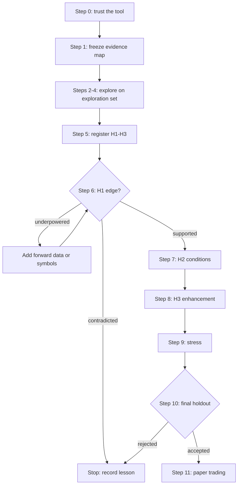

# ORB edge research plan

**Date:** 2026-10-31  
**Status:** Plan only; no new results in this document  
**Audience:** Bloom, and any agent running ORB research  
**Read with:** `2026-10-31-backtest-research-north-star.md` (Sections 5,
6.5 and 6.6), `2026-10-18-backtest-handoff.md`

## 1. Goal

Find out, with honest evidence, whether the opening range breakout (ORB)
strategy has a tradable edge. The plan answers four questions in order:

| # | Question | Answered by |
| --- | --- | --- |
| Q1 | Is there an edge? | Step 6 |
| Q2 | How large is it? | Step 6 |
| Q3 | In which market conditions does it hold? (the pre-screen or filter) | Steps 3 and 7 |
| Q4 | How can it be made larger? | Steps 4 and 8 |

Every confirmatory answer is one of **supported**, **contradicted** or
**underpowered**. "Not shown" is never reported as "shown absent".

The plan follows one principle: **explore on one set of data, confirm on
another, and decide what to confirm before looking at the confirmation
data.**

## 2. Evidence map

Data has two roles. Exploration data can be reused freely but can never
confirm. Confirmation data is spent the first time its results are viewed.

| Data | Role | Why |
| --- | --- | --- |
| QQQ, 2018-05 to 2024-12 | **Exploration** | Used for pipeline validation, legacy ORB experiments (HYP-001 to HYP-004) and two walk-forward studies. Reusable for any exploration. It can only confirm a hypothesis never examined on it |
| AMZN, GOOGL, MSFT, TSLA, 2018-05 to 2024-12 | **Exploration** (decided 2026-10-31) | ORB results were viewed once: the P5b universe check ran the ORB rule on all five symbols over a window of about 124 trades each and reported +0.44R to +0.78R (`2026-09-09-backtest-pipeline-implementation-plan.md`, "Cross-sectional result from P5b"). They are also configured for live trading |
| Other tickers with local history, 2018 to 2024, never run through ORB | **Confirmation set** | Never examined for ORB, so it can confirm hypotheses registered before its results are viewed |
| All symbols, 2025-01-01 to 2026-04-27 | **Final holdout** | Locked by `config/final_holdout.yaml`; read once at the end |
| All symbols, after 2026-04-27 | **Forward evidence** | Accrues at about 250 sessions per symbol per year; used for shadow and paper trading |

Notes:

- `config/final_holdout.yaml` already locks 2025-01-01 to 2026-04-27 for AMZN,
  GOOGL, MSFT, QQQ and TSLA.
- Most research used only QQQ, but the P5b check means AMZN, GOOGL, MSFT and
  TSLA are not fully fresh. Viewing one strongly positive window is enough to
  bias which hypotheses look attractive. **Decision (2026-10-31):** explore on
  all five and confirm on tickers never run through ORB. The confirmation
  tickers are chosen later, in Step 1.
- Five exploration symbols are a strength: a Step 3 or Step 4 pattern that
  appears on QQQ but not on the other four is probably noise.
- Every symbol added to the confirmation set should be added to the holdout
  lock **before** any of its data is run, so the final holdout covers the whole
  universe.
- Legacy findings on QQQ, such as "no take-profit" (HYP-003) and the
  break-even trailing stop (HYP-004), are **exploration findings**. They may
  shape hypotheses, but QQQ cannot confirm them.

## 3. Steps

Each step lists its purpose, data, procedure, outputs and the gate before the
next step. Steps 0 to 5 never touch confirmation data.

### Step 0: Trust the tool

**Purpose:** prove the platform measures edges correctly before using it to
measure one.  
**Data:** synthetic data and QQQ.

**Procedure** (north-star Section 6.3):

- V3 hand-verified QQQ sessions: gap up, gap down, no breakout, stop hit,
  end-of-day exit.
- V5 strategy-level look-ahead canary.
- V6 random-entry null across many seeds.
- V7 planted edge of known size.

**Outputs:** the reliability policy's measured false-positive rate and its
planted-edge detection rate.

**Gate:** the false-positive rate is near 5% or below, and detection matches
the power predicted in north-star Section 5. Otherwise fix the platform first.

### Step 1: Freeze the evidence map

**Purpose:** decide what counts as confirmation data before seeing anything.  
**Data:** metadata only, with no strategy runs.

**Procedure:**

1. List every ticker with local intraday history, its date range and data
   quality: missing sessions, splits, timestamps.
2. Apply a selection rule written in advance, for example: average daily dollar
   volume above a threshold, price above $10, at least 95% session coverage
   2018 to 2024. Decide ETFs, single stocks, or both as separate groups.
3. Commit a data manifest for the confirmation set, in the same form as
   `config/research/manifests/`.
4. Extend `config/final_holdout.yaml` to the confirmation symbols.

**Outputs:** frozen confirmation universe, manifest hash and holdout lock.

**Gate:** committed before any ORB run on those symbols.

### Step 2: Understand the baseline on the exploration set

**Purpose:** see what the baseline looks like and learn to read the report.  
**Data:** exploration set: QQQ, AMZN, GOOGL, MSFT and TSLA, 2018 to 2024.

**Baseline rule:** `vibe/rulesets/orb_production.yaml`:

- 5-minute opening range, symmetric direction, entry cutoff 15:00;
- stop at the opposite side of the range, no take-profit, exit at 15:55.

This choice is anchored to the published 5-minute QQQ ORB study (Zarattini
and Aziz, 2023), not to our own results.

**Procedure:**

- Run the baseline as **one fixed rule** over every session, with no
  selection. Use years or quarters only as a time-stability view.
- Produce the full experiment report from north-star Section 4:
  - stitched cumulative R and drawdown;
  - expectancy with its interval;
  - R histogram;
  - year-by-year bars;
  - exit reasons;
  - MAE/MFE (the largest move against and in favour of each trade) once
    recorded.

**Outputs:** a descriptive baseline and any implementation surprises.

**Gate:** the numbers are plausible and explainable. This step answers
nothing about the edge.

### Step 3: Explore market conditions (Q3)

**Purpose:** find at most two conditions under which the edge looks stronger
or weaker.  
**Data:** exploration set: QQQ, AMZN, GOOGL, MSFT and TSLA, 2018 to 2024.

**Procedure:**

1. Write down the candidate variables and their mechanisms *before* looking.
   Each must be known by entry time:

   | Variable | Mechanism |
   | --- | --- |
   | Relative opening volume (today's opening volume versus its recent average) | Unusual participation often means a catalyst, which sustains intraday trends (Zarattini, Barbon and Aziz, 2024) |
   | Overnight gap size and direction | Overnight news changes opening behaviour |
   | Opening-range width relative to ATR | Tight ranges may break more cleanly; wide ranges put the stop far away |
   | Volatility regime (ATR percentile, VIX if available) | A breakout needs movement to pay |
   | Prior multi-day trend | A breakout aligned with the trend may continue further |

2. For each variable, show expectancy by tercile (low, middle, high) with
   intervals and trade counts, overall and by year.
3. Keep a candidate only if the pattern is **monotonic** across terciles,
   holds in most years and most exploration symbols, and has a mechanism.

**Outputs:** at most two candidate filters, plus conditions where the edge
reliably fails (candidate no-trade days). All are labelled diagnostic.

**Gate:** candidates are written down with their mechanism and the observed
pattern. Every variable examined is counted as a trial.

### Step 4: Explore enhancements (Q4)

**Purpose:** find at most one bundled improvement to the baseline.  
**Data:** exploration set: QQQ, AMZN, GOOGL, MSFT and TSLA, 2018 to 2024.

**Procedure:** change **one lever at a time** against the baseline on the same
sessions and compare the per-session difference. That paired comparison is
much less noisy than comparing two separate backtests. Levers, in rough order:

1. **Exits:**
   - revisit HYP-003 (no take-profit) and HYP-004 (break-even trailing stop);
   - time exits;
   - use the MAE/MFE pattern to explain any change.
2. **Entry confirmation:** volume confirmation, the opening-range body filter.
3. **Opening-range duration:** a sweep such as 5/10/15/20/30 minutes. Look for
   a broad plateau, not a single best value.

Position sizing changes dollar returns and drawdown, not expectancy in R.
Treat it separately.

**Outputs:** one bundled enhanced rule, or "no enhancement worth testing".

**Gate:** the bundle is justified by mechanism or by an MAE/MFE pattern, not
only by having the best number. Every variant tried is counted as a trial.

### Step 5: Register the hypotheses

**Purpose:** fix exactly what will be tested before seeing confirmation data.  
**Data:** none.

Register up to three hypotheses, in order:

| ID | Claim | Rule |
| --- | --- | --- |
| H1 | The baseline has positive after-cost expectancy | Step 2 baseline |
| H2 | The condition from Step 3 changes expectancy, and the filtered rule is positive | Baseline plus at most two filters |
| H3 | The enhanced rule beats the baseline | Step 4 bundle |

For each hypothesis record:

- prediction and minimum edge of interest: **0.05R after costs** (decided
  2026-10-31);
- the minimum detectable edge on the confirmation set, computed with
  **day-clustered** uncertainty (average the day's R across symbols first,
  then compute the interval across days);
- its share of the false-positive allowance (5% split three ways, so 1.67%
  each);
- kill criteria and the exact analysis;
- updated final-holdout acceptance criteria for the confirmation universe.

Use the registration system (`vibe/research_pipeline/registration.py`) and a
`research_journal` hypothesis record.

**Gate:** user approval of all registrations. After this point no hypothesis
may change.

### Step 6: Confirm H1, edge existence and size (Q1, Q2)

**Data:** confirmation set, 2018 to 2024 (test 1 of 3).

**Report:**

- supported, contradicted or underpowered;
- expectancy with its interval, after-cost basis points per trade, trades per
  year and R per year;
- the **cost break-even**: the cost per trade at which expectancy reaches
  zero;
- per-symbol and per-year consistency.

**Gate:**

- **Contradicted:** stop. Do not test H2 or H3 to rescue the result.
- **Underpowered:** add forward data or more symbols under the same
  registration; do not change the rule.
- **Supported:** continue.

### Step 7: Confirm H2, where the edge holds (Q3)

**Data:** confirmation set (test 2 of 3).

**Report:** the interaction (high minus low tercile) with its interval, and
the filtered rule's expectancy. Judge the filter by **total edge** (R per
year), not expectancy alone, because a filter removes trades.

**Gate:** keep the filter only if supported.

### Step 8: Confirm H3, a larger edge (Q4)

**Data:** confirmation set (test 3 of 3).

**Report:** the paired difference versus the baseline with its interval, and
the enhanced rule's expectancy.

**Gate:** keep the enhancement only if supported. The confirmation set is now
spent and becomes exploration data.

### Step 9: Stress the surviving rule

**Data:** confirmation set.

**Procedure:**

- cost stress up to the break-even cost;
- neighbouring parameter values;
- regime splits;
- Monte Carlo trade resampling;
- leave-one-symbol-out;
- count of symbols with positive expectancy.

**Gate:** the rule survives realistic costs and does not depend on one symbol,
one year or one exact parameter.

### Step 10: Final holdout, once

**Data:** all locked symbols, 2025-01-01 to 2026-04-27.  
**Procedure:** authorize and run exactly once through the existing holdout
controls, and apply the acceptance criteria registered in Step 5.  
**Gate:** acceptance met, otherwise reject. The holdout is never rerun.

### Step 11: Forward and paper trading

**Data:** live data after 2026-04-27.  
**Purpose:** check that real fills, slippage and execution match the modelled
costs before risking capital.

## 4. Decision flow



## 5. What the viewer should show at each step

| Step | Key views |
| --- | --- |
| 0 | Reference experiments: what "no edge" and "known edge" look like |
| 2 | Stitched cumulative R, drawdown, R histogram, year bars, exit reasons, MAE/MFE |
| 3 | Expectancy by tercile per variable, with intervals, counts and year breakdown |
| 4 | Paired difference versus baseline per lever, with interval and trial count |
| 5 | Hypothesis cards: prediction, minimum detectable edge, false-positive share, kill criteria |
| 6–8 | Outcome badge, interval against the minimum edge of interest, per-symbol and per-year bars |
| 9 | Cost-stress curve, neighbour heatmap, Monte Carlo fan, leave-one-symbol-out bars |

## 6. Pipeline capabilities this plan needs

| Capability | Needed by | State |
| --- | --- | --- |
| Platform validation experiments V3, V5, V6, V7 | Step 0 | Implemented: `tests/platform_validation/` and `scripts/run_platform_validation.py` |
| Fixed-rule evaluation over all sessions, with folds only as a stability view | Steps 2, 6–8 | Implemented: `vibe/research_pipeline/fixed_rule.py`, `scripts/run_fixed_rule_study.py` |
| Multi-symbol study with pooled, day-clustered statistics | Steps 6–9 | Implemented: `fixed_rule.py` with `inference.py` (day-clustered estimates) |
| Conditional (tercile) breakdowns joined to causal session features | Steps 3, 7 | Implemented: `session_features.py`, `conditional.py`. `tercile_breakdown(cutoffs=...)` reuses frozen exploration cutoffs; the confirmation runner does not yet pass them (known gap for Step 7) |
| Paired-difference comparison between two rules | Steps 4, 8 | Implemented: `paired.py`, `scripts/run_paired_comparison.py` |
| MAE/MFE recording | Steps 2, 4 | Implemented: engine tracking, `run_trades.mae_r/mfe_r` (schema migration 17) |
| Program-wide trial counter | Steps 3–5 | Implemented: `trials.py`, `hypothesis_cards.py`, `scripts/show_trial_ledger.py` |
| Holdout lock for new symbols | Step 1 | Exists; needs a config change |
| Registration and data binding | Step 5 | Exists (merged from `backtest-roadmap-implementation`) |
| Parallel workers for independent runs | All steps (runtime only) | Planned, not blocking. See below |

The implementation of these capabilities is specified in
`2026-10-31-orb-edge-implementation-plan.md`.

### Planned optimisation: parallel workers

The runners use one CPU core. The first full Step 0 run took about 110 minutes
per suite at 10–20% total CPU on a 20-thread machine.

The work splits into independent units:

- V6/V7 studies (each uses seed `seed + i`);
- symbols in a fixed-rule study;
- the baseline and variant runs in a paired comparison.

Planned design:

- add a `--workers N` flag; the default is half the logical CPUs (`os.cpu_count() // 2`), and `--workers 1` keeps today's serial path;
- use `concurrent.futures.ProcessPoolExecutor`, because the engine is CPU-bound Python and threads would not help;
- workers only compute and return plain results; the parent process collects them in submission order and is the only writer to SQLite, so reports and stored experiments do not depend on the worker count;
- each worker loads its own ruleset and data (nothing shared or mutable).

Tests:

- reports from `--workers 1` and `--workers 4` must be identical for a small V6/V7 run and for a fixed-rule study on synthetic Parquet;
- a worker exception must surface as that unit's error without hanging the pool.

Expected effect: about 8–10× faster with 10 workers.

### How to run Steps 0, 2, 3 and 4

These need market data (`BACKTEST__DATA_DIR`). Use one `<db>` for the whole
programme so the trial ledger counts every study.

```powershell
# Step 0: platform validation
python scripts/run_platform_validation.py --suite all --studies 200 --sessions 500 --seed 1 --research-db <db>

# Step 2: baseline on the exploration set
python scripts/run_fixed_rule_study.py --title "ORB baseline, exploration set" `
  --ruleset vibe/rulesets/orb_production.yaml --symbols QQQ,AMZN,GOOGL,MSFT,TSLA `
  --start 2018-05-01 --end 2024-12-31 --evidence-role exploration `
  --programme orb_edge_2026 --trial-family baseline --trial-label orb_production `
  --research-db <db>

# Step 3: conditions (same command plus condition flags)
python scripts/run_fixed_rule_study.py ... --condition rel_open_volume --condition abs_gap_pct `
  --condition or_width_atr --condition atr_pctile --condition prior_trend_20d_pct `
  --trial-family condition --trial-label step3_conditions

# Step 4: one lever at a time
python scripts/run_paired_comparison.py --title "Break-even trail vs baseline" `
  --baseline-ruleset vibe/rulesets/orb_production.yaml --variant-ruleset <variant.yaml> `
  --lever exit.trailing_stop --symbols QQQ,AMZN,GOOGL,MSFT,TSLA `
  --start 2018-05-01 --end 2024-12-31 --evidence-role exploration `
  --programme orb_edge_2026 --trial-family enhancement --trial-label break_even_trail `
  --research-db <db>

# Trial ledger
python scripts/show_trial_ledger.py --programme orb_edge_2026 --research-db <db>
```

View results with the local viewer (`RESEARCH__DB_PATH=<db>`, `node
tools/backtest-research-viewer/server.mjs`). Exploration outputs are labelled
"cannot confirm".

## 7. Decisions

Decided on 2026-10-31:

- **Minimum edge of interest:** 0.05R per trade after costs.
- **AMZN, GOOGL, MSFT and TSLA stay in exploration** with QQQ, because of the
  P5b run.
- **Implementation starts before Step 1.** Steps 0, 2, 3 and 4 need no
  confirmation data.

Still open:

1. Which tickers form the confirmation set, and whether ETFs and single
   stocks are tested as separate groups. Step 1 is blocked on this.
2. The final-holdout acceptance criteria for the confirmation universe.

## 8. Sources

- Zarattini and Aziz, *Can Day Trading Really Be Profitable? Evidence of
  Sustainable Long-term Profits from Opening Range Breakout (ORB) Day Trading
  Strategy vs. Benchmark in the US Stock Market* (2023):
  <https://papers.ssrn.com/sol3/papers.cfm?abstract_id=4416622>
- Zarattini, Barbon and Aziz, *A Profitable Day Trading Strategy for the U.S.
  Equity Market*, Swiss Finance Institute Research Paper No. 24-98 (2024),
  available on SSRN.
